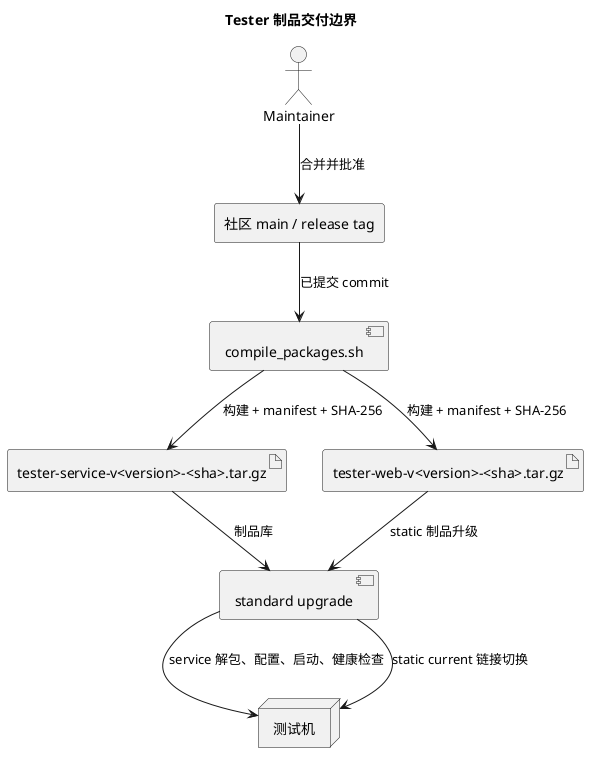
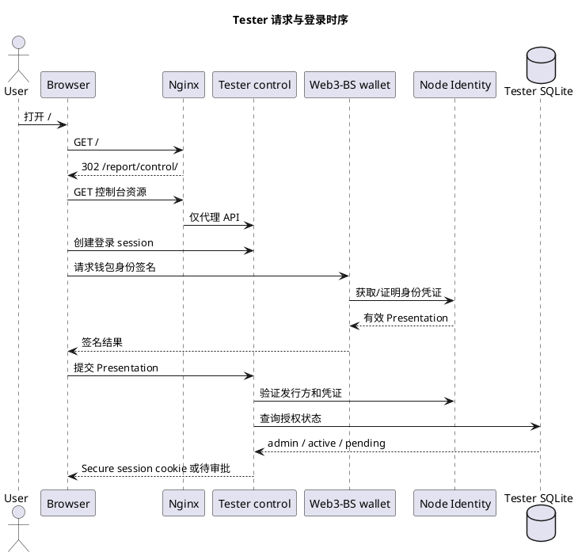

# Tester 部署手册

> 文档状态：In Review
> 适用环境：社区测试环境
> 维护对象：Tester 控制服务、测试运行器和控制台前端
> 打包规范：`books/yeying/specification/PACKAGING.md`
> 部署规范：`books/yeying/specification/DEPLOYMENT.md`
> 升级规范：`books/yeying/specification/UPGRADING.md`

本手册只说明如何部署已经生成的 Tester 安装包。打包输入、制品命名、manifest、SHA-256 和不可变制品规则以社区打包规范为准；本项目不从源码目录直接作为正式部署对象。

## 1. 部署对象

Tester 由一个 `service` 制品和一个 `static` 制品组成。service 包含 Playwright 测试运行器、Python 控制服务、报告处理脚本和浏览器运行时；static 包含控制台页面、资源和钱包 SDK。控制服务监听本机回环地址，Nginx 提供静态页面并只代理 API。

制品命名规则：

```text
tester-service-v<major>.<minor>.<patch>-<source-commit-7>.tar.gz
tester-web-v<major>.<minor>.<patch>-<source-commit-7>.tar.gz
```

包内固定入口：`scripts/starter.sh`、`scripts/health-check.sh`、`scripts/test.sh`、`scripts/upgrade.sh`。

## 2. 安装包信息

通过受控发布入口生成制品：

```bash
cd /root/code/deployer/operator/upgrade
./compile_packages.sh --publish
```

发布完成后核对 `release-manifest.json` 中的 `source_commit`、归档名和 SHA-256。制品由标准发布流程上传到配置的制品库；目标机上的 Deployer 升级器下载并验证该不可变制品。不要手工重命名包、覆盖同名不同字节包或从工作区直接复制文件。

### 制品边界

`release-manifest.json` 同时声明 `tester-service` 和 `tester-web`。service 安装到 `/opt/deploy/tester`，static 按标准静态制品目录安装到 `/opt/deploy/static/tester-web/current`。两个制品可以独立升级；页面由 Nginx 提供，API 仍由 Tester control service 提供。



### 从旧合包版本迁移

旧 service 制品曾同时托管页面；新 service 只提供 API。迁移时先在 Deployer 的 `operator/upgrade/static-units.conf` 中启用以下行（最后一列替换成实际 HTTPS 入口），使标准升级器能发现静态单元：

```text
tester tester-web tester-web https://<tester-domain>/report/control
```

然后进入维护窗口，先安装本仓库的 Nginx static/API 分离配置并平滑重载，再运行 Deployer 的标准 `upgrade.sh`。这一步切换到尚未安装的 `current` 静态目录后，控制台会短暂返回 404，直到升级器部署 `tester-web` 并通过 `/report/control/index.html` 探活。升级失败时，按已备份的 Nginx 配置和 service 制品回滚。升级完成后核对两个制品版本，并额外验证页面、钱包 SDK 与 API；控制服务自身健康检查只验证 service。

## 3. 目标环境准备

目标机器必须符合社区 `books/yeying/specification/MACHINE.md` 的目录、权限和磁盘要求，并准备：

- Linux x86_64、Python 3.10+、Node.js 24.18+。
- Bash、coreutils、`flock`、Xvfb、Bubblewrap 以及 Chromium 所需系统库。
- `/opt/deploy/tester` 作为稳定入口；版本目录由标准升级器创建。
- `/data/test-results` 保存公开报告，`/data/test-results-private` 保存控制状态和报告 Nginx 配置。
- `/data/tester` 保存 PID、运行锁和临时数据；`/opt/logs` 保存服务日志。
- 受保护的 runtime、项目配置、测试环境变量和管理员 DID。凭据文件权限为 `600`，私有目录权限为 `700`。
- 产品 E2E 所需的产品服务和公共中间件。Tester 负责排队、部署适配器和运行用例，不负责自动启动所有产品及中间件。

## 4. 配置初始化

以安装包中的模板为准维护外置运行配置。不要覆盖部署机已有值；服务启动时，systemd 的 `TESTER_RUNTIME_CONFIG` 指向是实际生效 runtime 的来源。当前测试环境使用私有 runtime 和独立项目清单：

```bash
systemctl show tester-control.service --property=Environment --value
stat -c '%a %n' /data/test-results-private/control/runtime-artifact.json
stat -c '%a %n' /data/test-results-private/control/consolidated-projects.json
```

复制新环境模板时，先确认模板中的绝对路径与 systemd、部署器和持久化目录配置一致，再设置权限；不要把真实身份 DID 或凭据写进公开文档。

运行配置至少确认：

- `TESTER_CONTROL_CONFIG` 指向项目 watcher 配置。
- `TESTER_PRIVATE_REPORT_DIR`、`TESTER_REPORT_DIR`、`TESTER_PID_FILE` 和 `TESTER_LOCK_FILE` 指向持久目录。
- `TESTER_CONTROL_ORIGIN` 与用户访问控制台的 HTTPS origin 完全一致。
- `TESTER_ADMIN_DID` 是已经完成 Node 身份注册、邮箱验证和钱包绑定的管理员 DID。
- `TESTER_IDENTITY_ISSUER_URL` 指向受信任的身份发行方。
- `TESTER_ENV_FILE` 指向 E2E 环境变量文件；其中的 API key、钱包私钥和 Webhook secret 不写入报告。

GPU 测试机的配置快照由 `scripts/config_backup.sh` 生成。按本手册回滚时，优先使用现有受保护快照并保留该机 runtime 指向，不要用仓库模板覆盖已配置的生产/测试值。

Tester 授权数据库是服务私有 SQLite 文件，启动时自动执行 `scripts/migrations/` 中未执行的迁移。它不需要另行启动 PostgreSQL；配置数据库路径由 `TESTER_PRIVATE_REPORT_DIR` 下的控制目录决定。

## 5. 部署和启动

标准升级器执行下载、校验、解包、保留配置、停止旧版本、启动新版本、健康检查和稳定链接切换。升级成功后通过稳定入口执行：

```bash
cd /opt/deploy/tester
scripts/starter.sh start
scripts/health-check.sh --level readiness --format json
scripts/health-check.sh --level all --format json
scripts/test.sh --suite smoke --format json
```

如果使用 systemd 管理控制服务，单元只调用安装包内的 `scripts/starter.sh`；不要把产品服务塞进 Tester 的 systemd 单元。

Nginx 必须包含项目提供的 [`scripts/nginx-control-location.conf`](../scripts/nginx-control-location.conf)：根路径 `/` 重定向到 `/report/control/`，静态页面从 `/opt/deploy/static/tester-web/current` 提供，只有 `/report/control/api/` 代理到 `127.0.0.1:18082`。钱包登录请求不受报告 Cookie 或 Basic Auth 额外拦截，`client_max_body_size` 至少为 `1m`。修改后执行：

```bash
nginx -t
# 使用实际运行中的 Nginx master 做平滑重载
nginx -s reload
```



## 6. 验证方式

公网入口至少验证：

```bash
curl -I https://<tester-domain>/
curl -i https://<tester-domain>/report/control/api/auth/status
curl -I https://<tester-domain>/report/control/web3-bs.js
```

预期结果：根路径 `302` 到 `/report/control/`；匿名认证状态 `401`；Wallet SDK 返回 `200`。登录后再确认控制台能读取 `/api/status`、`/api/cases` 和 `/api/architecture`，管理员能看到成员授权入口。

E2E 环境按项目依赖图和测试机架构手册逐项确认。Tester 自身 `health-check.sh --level all` 只证明 Tester runner 和控制服务可用，不代表所有产品服务、中间件或跨项目依赖已启动。

## 7. 备份、迁移和回滚

每次升级前执行配置备份：

```bash
/opt/deploy/tester/scripts/config_backup.sh
```

备份包含 runtime、项目配置、环境变量引用的受保护配置、Tester SQLite 授权数据库、systemd unit/drop-in 和 Nginx 配置；不包含测试结果、运行日志和公开报告。远端上传只有在专用 WebDAV 目标已经验证后才能启用。

Tester 当前 migration 是本地 SQLite 授权表迁移，由控制服务启动时唯一执行。迁移失败时服务必须保持失败，不得继续接收登录或测试操作；先保留旧版本和备份，再按升级规范安全重试或执行经评审的 forward-fix。没有数据库 migration 时不得把进程存活当成部署成功。

回滚使用 Deployer 的标准升级流程选回上一个完整制品版本；保留旧版本目录和相应配置快照。不要手工替换稳定链接绕过 starter 和健康检查。执行入口为部署环境中 Deployer 的 `operator/upgrade/upgrade.sh`：

```bash
cd <deployer-checkout>/operator/upgrade
./upgrade.sh
```

升级器健康检查失败时保持旧稳定链接；人工回滚后再次执行 readiness、all 和 smoke 检查，并确认控制台登录、报告读取和运行锁均恢复。

## 8. 常见问题

### 根路径显示 Welcome to nginx

HTTPS server 没有 `/` 重定向，命中了默认站点。将 `scripts/nginx-control-location.conf` 的根路径 location 合并到实际监听 443 的 Nginx 配置，执行 `nginx -t` 并平滑重载真正的 master。

### `/report/control/` 返回 403

检查是否仍有报告 Cookie 门禁或 Basic Auth 规则覆盖控制 location。钱包登录由 Tester 控制服务负责，控制 location 不应复用报告访问 Cookie。

### 页面打开但脚本 404

确认 `tester-web` static 制品已升级且 Nginx 指向其 `current` 目录；确认 API 代理到同版本 control service。不要从旧 checkout 补拷贝前端文件。

### 登录后提示等待授权

管理员 DID 尚未批准该身份。管理员先完成钱包登录，再在“成员授权”中批准；确认 Node issuer、邮箱验证和钱包绑定状态有效。

### smoke 或 E2E 大量连接失败

先查看项目依赖图和测试机架构手册，逐个检查产品服务与公共中间件 readiness。Tester 不会因为自身启动成功而自动启动缺失依赖。

## 9. 相关文档

- [测试控制台和钱包授权](test-control.md)
- [测试机架构与服务启动](test-machine-architecture.md)
- [项目与 E2E 依赖图](project-dependency-map.md)
- [测试报告和调度](test-machine-report.md)
- 社区打包规范：`books/yeying/specification/PACKAGING.md`
- 社区部署规范：`books/yeying/specification/DEPLOYMENT.md`
- 社区升级规范：`books/yeying/specification/UPGRADING.md`

## 10. AI 协作记录

- 使用大模型起草：是。
- 使用范围：整理现有 Tester 配置、部署步骤、常见问题和 PlantUML 草图。
- 依据：社区 `PACKAGING.md`、`DEPLOYMENT.md`、Tester 当前 package scripts、配置模板、Nginx 片段和测试机架构文档。
- 人工复核状态：待维护者确认目标机差异、备份恢复步骤和发布节点的实际制品库配置。
