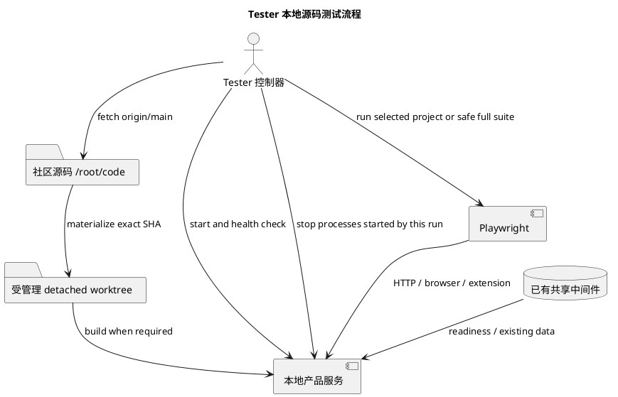

# 本地源码测试模式

本模式用于在测试机上直接运行社区产品 `main` 源码，再执行 Tester 的 Playwright 用例。它与已发布制品测试分开：Tester 仍由自己的服务包运行，产品服务由 `/root/code` 下的受管理源码工作树临时启动，测试结束后只停止本次启动的进程。

## 工作方式



启动器只使用每个项目自己的开发入口和健康端口。PostgreSQL、Redis、MySQL、Mailpit 等共享中间件必须已经启动；启动器不会执行 `down -v`、重置数据库或覆盖项目配置。Router 每次运行使用独立 PostgreSQL 数据库，停止测试时自动删除；它不会连接共享的 Router 业务数据库。每个源仓库先抓取 `origin/main`，然后在运行目录下创建 detached worktree，避免修改 `/root/code` 中的分支和未提交文件。npm、Go、Python/uv 和 Maven 下载默认使用国内镜像；可由服务进程环境变量覆盖。产品仓库缺失、远端 `main` 不可达、依赖中间件未就绪或端口被未知进程占用时，运行会在启动阶段失败。

源码服务默认使用产品开发端口加固定偏移量，避免与当前测试环境中的旧服务冲突；实际端口会写入本次运行的私有环境文件。可通过 `TESTER_LOCAL_PORT_OFFSET` 调整偏移量，不能把服务地址改成公网地址。

## 运行命令

在 Tester 源码目录执行：

```bash
export TESTER_LOCAL_SOURCE_MODE=1
export TESTER_PRODUCT_SOURCE_ROOT=/root/code
export TESTER_ENV_FILE=/data/test-results-private/control/tester.env

# 先只检查某个项目所需源码和中间件
python3 scripts/local_test_readiness.py router \
  --source-root "$TESTER_PRODUCT_SOURCE_ROOT" \
  --env-file "$TESTER_ENV_FILE" \
  --require-services

# 运行一个项目；结束后自动停止本次启动的服务
scripts/test-tester-main.sh --project router

# 全部 11 个项目（本地源码模式包含 Knowledge）
scripts/test-tester-main.sh
```

控制服务使用相同的环境变量时，控制页的“单项目测试”和“全量测试”会走本地源码启动器。若只想验证启动计划，可直接执行：

```bash
python3 scripts/local-source-services.py start router \
  --source-root /root/code \
  --env-file /data/test-results-private/control/tester.env
python3 scripts/local-source-services.py stop router
```

如果本地目标端口已被占用，启动器会停止并要求先处理该进程，避免把旧制品的服务误认成源码服务。Project 启动会执行该项目自己的迁移命令，必须显式设置 `TESTER_LOCAL_ALLOW_DB_MIGRATIONS=1`，且确认使用的是可重建测试库。

## 当前依赖闭包

| 测试范围 | 会启动的源码服务 | 预先需要的共享中间件 |
| --- | --- | --- |
| Books / Marketplace | 无常驻服务，直接检查仓库 | 无 |
| Wallet | Node、Router、Warehouse（按具体 dApp 用例使用） | PostgreSQL、Redis、Mailpit（身份流程需要时） |
| Node | Node API 与 Web | PostgreSQL、Redis、Mailpit |
| Router | Node、Router API 与 Web | PostgreSQL、Redis、Mailpit |
| Warehouse | Warehouse API/WebDAV/S3 与 Web | PostgreSQL；对象存储按配置决定 |
| Chat | Chat、Router、Warehouse | Router/Warehouse 依赖的中间件；实时模型用例还需要 Router BYOK 配置 |
| Social | Social platform/server/RTC/identity 与 Web | MySQL、Redis |
| Project | Project 与 Warehouse | MySQL、Redis；Office/PlantUML 按用例决定（当前两者均已启动） |
| Knowledge | Knowledge API 与 Web | 依产品配置决定 |
| Orchestrator | Orchestrator backend 与 Web，并连接 Router/Warehouse | PostgreSQL 按产品配置决定；GPU 仓库已准备好，backend `.env` 尚未配置 |

本地源码模式下的全量运行会对全部 11 个 Tester 项目依赖闭包取并集，并按“中间件就绪 → Node/Router/Warehouse → Chat/Social/Project/Knowledge/Orchestrator → Web”顺序启动。普通制品模式仍保留安全全量配置排除 Knowledge 的既有规则。当前 Orchestrator 还缺 backend `.env`；Project 有 218 条迁移记录，启动时会自动应用新迁移。Social Flyway 有 5 条成功迁移记录，源码服务启动时还需确认开发 profile 与已有数据库配置一致。

## 运行目录与日志

默认运行目录是 `/data/test-results-private/control/local-source`，其中保存源 worktree、构建标记、进程日志和本次状态文件。该目录属于私有运行状态，不发布到报告站点。若需要迁移到其他测试机，可设置 `TESTER_LOCAL_RUNTIME_DIR`，并确保运行用户对目录有读写权限。
