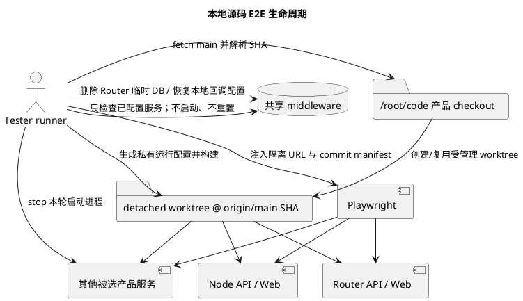

# 本地源码测试模式

本模式以社区产品仓库 `origin/main` 的精确 commit 为被测服务，在 GPU 测试机上创建受管理的 detached worktree、启动产品服务、运行 Playwright，然后回收本轮启动的进程。它用于验证产品源码之间的真实集成；Tester 本身仍由已部署制品提供。

本模式与制品模式的结果必须分别标记。制品模式连接既有服务，不会自动启动产品；本地源码模式启动依赖闭包，但需要共享 middleware 和产品运行配置预先就绪。

## 生命周期



运行器会先 fetch 每个依赖仓库，再只在私有运行目录创建 detached worktree；不会切换或清理 `/root/code` 原工作树。启动期间的运行端口、环境覆盖、日志和 source commit manifest 保存在 `TESTER_LOCAL_RUNTIME_DIR`。测试结束后自动停止本轮产品服务。

Router 使用命名形如 `tester_router_e2e_<随机后缀>` 的独立 PostgreSQL 数据库，退出时删除，不连接 Router 正式业务库。Node 身份场景使用现有本地 Node 测试库和已配置应用：启动时将该应用的 redirect URI 临时改成隔离 Router 回调地址，停止时恢复原值。若进程被 `SIGKILL` 或主机掉电打断，自动清理可能来不及完成；先检查私有运行状态文件，再用 `local-source-services.py stop` 清理，不要盲目删除数据库或改回调。

Node API 与 Web 必须使用不同端口。若历史 `tester.env` 将两者配置为同一地址，当前启动器会保留 Node API 端口，并把 Node Web 放在开发默认端口加 offset 的地址。本地源码 Router 测试的 API 目标来自运行器生成的私有环境，不得固定覆盖到正式 Router 端口。

## 前置条件

- `/root/code` 下的产品仓库是可 fetch 的 Git checkout，且 `origin/main` 可访问。
- PostgreSQL、Redis、MySQL、Mailpit 等项目依赖 middleware 已按依赖图启动，账号、数据库和 migration 完成。
- `/data/test-results-private/control/tester.env` 等私有配置有效且权限受限。
- Node `run/secrets.enc.json` 与解密口令、Router 配置和 Node 身份应用已准备好。
- 被测浏览器依赖已装好，Node/npm、Go、Python/uv、Maven 和系统浏览器隔离依赖可用。
- 用 `local_test_readiness.py` 检查选定项目。一个项目预检通过不代表所有项目的依赖都齐备。

Orchestrator backend `.env` 仍是需要按服务规范单独配置的前置条件；不要从其他项目复制秘密。Project/Social 会连接已有数据库并可能执行项目自身 migration；运行前应确认库用途、账号和 migration 状态。启动器不会替它们清空或重建共享库。

## 操作步骤

在 Tester checkout 中先检查依赖：

```bash
cd /root/code/tester
export TESTER_PRODUCT_SOURCE_ROOT=/root/code
export TESTER_ENV_FILE=/data/test-results-private/control/tester.env

python3 scripts/local_test_readiness.py router \
  --source-root "$TESTER_PRODUCT_SOURCE_ROOT" \
  --env-file "$TESTER_ENV_FILE" \
  --require-services
```

运行单项目源码 E2E：

```bash
export TESTER_LOCAL_SOURCE_MODE=1
scripts/test-tester-main.sh --project router
```

运行本地源码模式安全全量（包含 Knowledge）：

```bash
export TESTER_LOCAL_SOURCE_MODE=1
scripts/test-tester-main.sh
```

Tester 控制服务的手动单项目/全量入口使用相同运行配置时也会调用本地源码启动器。输出的 source manifest 应随报告保留，以便知道实际测试了哪些 commit。若服务因配置、数据库或 middleware 未就绪而无法启动，应记为 blocked/preflight failure，不能记成产品用例失败或通过。

## 显式启停与恢复

需要单独观察启动过程时，可直接启动和停止一个项目：

```bash
python3 scripts/local-source-services.py start router \
  --source-root /root/code \
  --runtime /data/test-results-private/control/local-source \
  --env-file /data/test-results-private/control/tester.env

python3 scripts/local-source-services.py stop router \
  --source-root /root/code \
  --runtime /data/test-results-private/control/local-source \
  --env-file /data/test-results-private/control/tester.env
```

发生中断时先找到对应 `state.json`，核实其中记录的 PID、worktree、临时 DB 和 Node redirect 更新，再用同一 runtime/state 参数调用 `stop`。确认隔离端口已关闭、Router E2E 数据库已删除、本地 Node callback 已恢复后再重跑。

## 当前 Router 验证基线

2026-11-25 使用隔离 Node API/Web、Router API/Web 与 Router E2E 数据库完成源码回归：**109 项中 98 通过、0 失败、11 跳过**。跳过项是测试配置或产品开关相关前置条件。该结果验证 Tester `main` 当前本地源码适配，不表示 GPU 上当时安装的旧 Tester 制品已包含修复；运行结论要同时记录 Tester 版本/commit、产品 source commit、项目计数和跳过原因。

## 相关文件

- `config/local-test-dependencies.json`：项目到仓库和服务的依赖闭包。
- `scripts/local_test_readiness.py`：源码、配置和 middleware 预检。
- `scripts/local-source-services.py`：detached worktree、运行配置、服务启停和清理。
- `scripts/run-full-on-test-machine.sh`：单项目/全量 runner 与结果发布。
- `scripts/test_local_source_mode.py`：依赖闭包、配置隔离和启停规则测试。
- [测试环境现状](test-machine-architecture.md)：GPU 主机实际状态；[依赖关系](project-dependency-map.md)：逻辑关系图。
