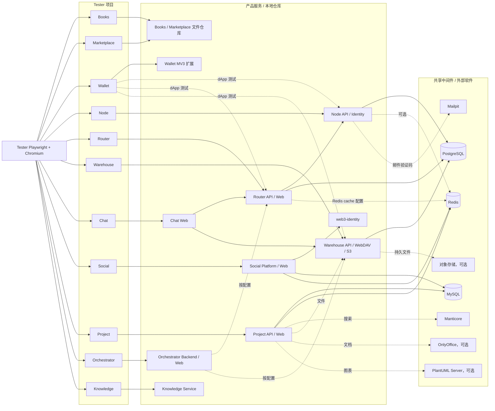

# YeYing 项目与 E2E 依赖图

这份关系图面向 Agent、Tester 维护者和社区成员，概览每个 Playwright 项目连接的产品服务、本地仓库、共享中间件和外部软件。它描述测试可能需要的运行依赖，不表示 Tester 会自动启动这些服务，也不代表每条用例都需要全部依赖。

在线只读关系图：`/architecture`。它不要求 Tester 控制台登录；页面只展示经过整理的项目名称和依赖说明，不包含主机地址、部署路径、凭据或环境状态。测试用例脑图位于 `/cases`，需要钱包身份登录。

## 关系总览

图中实线表示产品或测试路径中的主要关系；虚线表示按具体测试场景或部署配置启用的可选关系。Node 身份凭证发行服务属于 Node，不与 Social 使用的独立 `web3-identity` 服务混为一谈。

## 项目依赖速查

| Tester 项目 | 主要目标 | 测试中可能需要的其他服务 | 常见共享依赖 |
| --- | --- | --- | --- |
| Books | Books 文档仓库 | 无 | 无 |
| Marketplace | Marketplace 技能与 Tool Server 仓库 | 在线站点冒烟时需要 Marketplace Web | 无 |
| Wallet | Wallet MV3 扩展 | Node、Router、Warehouse dApp 页面，按测试文件而定 | Chromium；对应服务自己的中间件 |
| Node | Node API 与 Web | Mailpit 支持邮件验证码用例 | PostgreSQL；Redis 可选 |
| Router | Router API 与 Web | Node 身份凭证；真实邮箱身份流程还需 Mailpit | PostgreSQL；Redis cache 可选 |
| Warehouse | API、WebDAV、S3 与 Web 管理界面 | 可选持久对象存储 | PostgreSQL |
| Chat | Chat Web 应用 | Router 模型/令牌；Warehouse WebDAV 文件同步 | 依赖服务使用的中间件 |
| Social | Platform API 与 Web | `web3-identity` | MySQL、Redis |
| Project | Project API 与 Web | Warehouse 文件、OnlyOffice 文档、PlantUML 图表按用例启用 | MySQL、Redis；Manticore 可选 |
| Orchestrator | Backend 与 Web | Router 模型目录、Warehouse 资产按配置启用 | 配置 PostgreSQL 时使用 PostgreSQL |
| Knowledge | 知识检索服务 | 以 Knowledge 产品配置为准 | 安全全量配置当前排除该项目 |

## 谁负责启动

Tester 负责排队和运行用例，不负责拉起共享中间件或产品服务。PostgreSQL、Redis、MySQL、Mailpit、Manticore 等由 Deployer middleware 或相应运维流程启动；产品服务由项目自己的部署或启动入口管理。启动顺序、当前测试机配置和逐项验证步骤见[测试机架构与环境运行手册](test-machine-architecture.md)。

关系图的数据源是 [project-dependency-map.json](project-dependency-map.json)。新增项目、调整 E2E 集成或改变产品中间件依赖时，应同时更新数据源和本页速查表，并验证在线图能呈现新关系。
