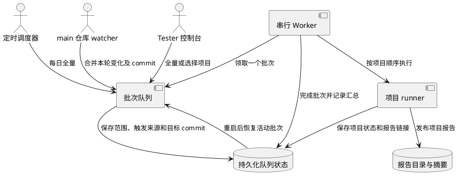

# Tester 触发与测试批次设计

## 目标

定时全量回归、社区仓库 `main` 更新和控制台手动操作都进入 Tester 的同一个持久化队列。一次触发生成一个批次，批次包含全量范围或一个/多个项目，并记录触发来源、目标提交、各项目结果和报告链接。

## 触发与批次范围

| 触发方式 | 范围 | 入口 | 合并规则 |
| --- | --- | --- | --- |
| 每日计划 | 当前配置的全量测试范围 | 控制服务调度线程 | 每个本地日期最多生成一个计划批次。服务在计划时间后重启时，若当天尚无计划记录，会补入当天批次 |
| 项目 `main` 更新 | 本轮轮询发现变化的项目 | 上游仓库 watcher | 同一轮发现的多个仓库变更合成一个批次，每个项目固定到发现时的 commit。批次等待期间发现的新 commit 更新对应项目的目标 commit |
| Tester 控制台 | 全量或勾选的一个/多个项目 | `POST /api/run` | 全量、单项目、多项目均作为一个批次入队。同一来源、范围和模式已有活动或等待批次时复用 |
| Tester 自身 `main` 更新 | 全量测试范围 | Tester watcher | Tester 代码更新用完整测试范围验证，不作为产品项目增量批次 |

`main` watcher 只处理项目清单中启用且有已验证隔离部署适配器的项目。当前部署适配器覆盖 Book、Chat、Marketplace、Router、Wallet。旧项目键 `books` 会规范化为 `book`；没有部署适配器的配置项会自动保持 watcher 关闭，但仍可手动单项目测试，也会保留在全量 Playwright 范围内。新增适配器前需要有可重复部署、健康检查和清理流程。

制品模式下，Watcher 先用固定 SHA 更新并验证产品，再直接调用当前安装包内的项目 runner。源码开发模式则先准备 Tester 的上游 Git worktree，再运行项目用例。标准安装包不包含 `.git`，部署适配器不能从制品目录启动 Tester Git worktree。

## 执行与恢复



队列当前并发度为 1。不同触发来源共用同一个 worker 和 runner 文件锁，因此手动点击、定时任务和仓库更新不会并行修改测试环境。多项目批次按稳定的项目名顺序执行，每个项目完成后保存结果。进程在中途退出时，服务重启会将活动批次放回队列，已完成项目会复用结果，只继续未完成项目。Runner 因已有测试占用锁而返回重试码时，批次保留在队列中等待重试。

队列状态保存在私有 `state.json`。它持久化活动批次、等待批次、每日计划日期和最近完成的 30 个批次。服务启动时恢复未完成批次，并在计划时间已过且当天尚未排程时补入当天的全量批次，不追补更早日期。每个项目的报告仍由报告目录和 SQLite 报告索引长期保存。控制台状态 API 返回最近 12 个批次，不返回 runner 私有日志路径。每个项目报告的运行元数据包含共同的 `batch_id`、项目名和触发来源，Skill 分析 API 可据此核对批次内的报告。

同一批次中的每个项目都有独立 runner request ID，避免覆盖另一项目的摘要。批次 ID 通过 `batch.json` 关联各项目运行记录。全量批次包含一个全量 runner，项目级批次则分别执行其所选项目。

## HTTP 契约

手动触发需要有效钱包会话、同源 `Origin` 和 CSRF 值。请求示例：

```json
{"scope":"full"}
```

```json
{"scope":"projects","projects":["router","wallet"]}
```

单项目兼容请求仍可使用 `{"project":"router"}`。服务端规范化并排序项目列表、拒绝空列表和未知项目，再原子地复用或创建队列批次。`202` 响应包含批次 ID。`GET /api/status` 提供活动批次、等待批次、最近完成批次及各项目的忙碌状态。

完整字段、鉴权和错误响应见 [OpenAPI 契约](openapi.yaml) 的 `/api/run` 与 `/api/status`。

## 配置

| 变量 | 建议值 | 作用 |
| --- | --- | --- |
| `TESTER_DAILY_RUN_ENABLED` | `true` | 启用每日全量批次 |
| `TESTER_DAILY_RUN_TIME` | `03:00` | 每日触发时间 |
| `TESTER_DAILY_RUN_TIMEZONE` | `Asia/Shanghai` | 调度时区 |
| `TESTER_WATCH_UPSTREAM_MAIN` | `true` | 启用 main 分支轮询 |
| `TESTER_MAIN_POLL_SECONDS` | `300` | 仓库轮询周期，代码默认五分钟 |
| `TESTER_ALLOW_PRODUCT_SOURCE_DEPLOY` | `true` | 允许 watcher 调用项目隔离部署适配器 |

配置位于部署实例的受保护 `runtime.json`。修改后应通过 Tester starter 重启控制服务，并核验健康检查、`/api/status` 和服务日志。每日计划由控制服务管理，避免同时配置重复 cron。

## 验收条件

- 每日计划在配置的时区和时间生成一个全量批次，进程重启不重复排入同一日期。
- 同一轮多个项目的 `main` 更新只产生一个批次，各项目提交 SHA 与 watcher 发现时一致。
- 待执行期间的更新只替换该项目的待测 SHA，不改变活动批次。
- 控制台和 API 可以创建全量、单项目、多项目批次，并将并发重复请求原子地合并。
- 所有批次共用串行 worker。批次状态、项目结果、提交 SHA 和报告链接在服务重启后可恢复。
- 项目报告和 Skill 分析结果能显示共同批次 ID、触发来源和项目提交。
