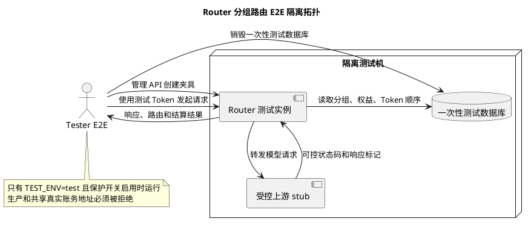
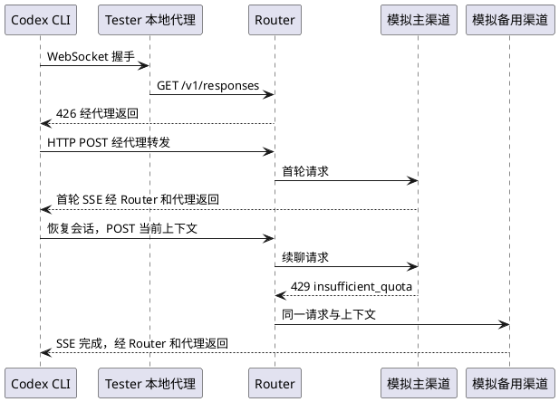

# 路由 Router — 端到端测试用例

> 测试人员视角整理的**应有** E2E 用例清单,作为实现依据。
> 状态说明:✅ 已实现(链接到 spec) / ⬜ 待实现。文末“待评审”方案不计入下方覆盖数量，评审通过后再纳入正式用例与进度统计。
> 端点:管理 UI 5181(Vite/static artifact) + API 3011(Go)· 自定义 SIWE
> 最后更新:2026-11-18

## 覆盖总览

| 模块                                    | 用例数  | 已实现  | 待实现 |
| --------------------------------------- | ------- | ------- | ------ |
| 一、服务健康与公共信息                  | 7       | 7       | 0      |
| 二、钱包自定义 SIWE 鉴权                | 11      | 9       | 2      |
| 三、鉴权与权限边界(混合信封)            | 8       | 8       | 0      |
| 四、管理后台 UI 与登录导航              | 14      | 14      | 0      |
| 五、工作台只读页面                      | 7       | 7       | 0      |
| 六、令牌(Token)生命周期                 | 10      | 10      | 0      |
| 七、充值与订单生命周期                  | 8       | 3       | 5      |
| 八、余额与兑换码                        | 5       | 3       | 2      |
| 九、个人中心与账户设置                  | 5       | 5       | 0      |
| 十、OpenAI 兼容模型与中继               | 6       | 5       | 1      |
| 十一、个人供应商路由(BYOK)              | 10      | 9       | 1      |
| 十二、渠道与供应商管理(管理员)          | 8       | 7       | 1      |
| 十三、钱包身份登录(真实 Node + Mailpit) | 2       | 1       | 1      |
| 十四、管理员站点级令牌管理              | 5       | 5       | 0      |
| 十五、渠道账务采购快照(管理员)          | 2       | 2       | 0      |
| 十六、渠道告警中心(管理员)              | 3       | 2       | 1      |
| 十七、模型中心状态与排行                | 5       | 5       | 0      |
| **合计**                                | **116** | **102** | **14** |

> 说明:Router API 由 Go 服务监听 `:3011`;React 管理后台是独立 Web 制品,本地开发默认监听 `:5181`,并将 `/api` 代理至 Go 服务。
> 钱包是唯一登录方式(`password_login_enabled=false`、`password_register_enabled=false`)。
> 自定义 SIWE 挑战格式(非 EIP-4361):
> `Login to <SystemName>\nNonce: <hex>\nAddress: 0x...\nIssued At: <RFC3339>`。
> **混合信封**是本产品的核心测试点:`/auth/verify` 用 `{success, data, message}`,
> `/profile`、`/user/*` 用 SDK 信封 `{code, data, message, timestamp}`。
> 环境变量:`ROUTER_BASE_URL`(API,默认 `http://localhost:3011`)、`ROUTER_WEB_URL`(UI,默认 `http://localhost:5181`)、`ROUTER_WALLET_PRIVATE_KEY`、`ROUTER_EXPECTED_ADDRESS`。
> 模块十一/十二新增:`ROUTER_ADMIN_PRIVATE_KEY`(地址须在部署的 `bootstrap.root_wallet_address`,用于管理员/渠道用例)、
> `ROUTER_ADMIN_EXPECTED_ADDRESS`、`ROUTER_PERSONAL_UPSTREAM_BASE_URL`/`_KEY`/`_MODEL`(个人供应商 BYOK 上游)。

---

## 一、服务健康与公共信息

### RT-API-001 GET /status 返回路由配置

- 优先级:P0
- 类型:API
- 状态:✅ 已实现 — products/router/tests/api.spec.ts
- 前置条件:Router API 在 `ROUTER_BASE_URL` 可达。
- 步骤:
  1. GET `/api/v1/public/status`。
- 预期结果:200;`success=true`;`data.system_name` 非空;`data.register_enabled`、`data.wallet_login`、`data.password_login_enabled` 均为布尔;含 `version`、`quota_per_unit`、`jwt_expire_hours` 等字段。

### RT-API-002 GET /topup/plans 返回充值套餐列表

- 优先级:P1
- 类型:API
- 状态:✅ 已实现 — products/router/tests/api.spec.ts
- 前置条件:服务可达。
- 步骤:
  1. GET `/api/v1/public/topup/plans`。
- 预期结果:200;`success=true`;`data` 为套餐数组(可能为空但字段合法)。

### RT-API-003 GET /billing/currencies 返回可用计费货币

- 优先级:P2
- 类型:API
- 状态:✅ 已实现 — products/router/tests/public-info.spec.ts
- 前置条件:服务可达。
- 步骤:
  1. GET `/api/v1/public/billing/currencies`。
- 预期结果:200;`success=true`;`data` 为对象,含 `default_currency` 与 `items` 数组,每项含货币代码 `code`(如 CNY/USD)。

### RT-API-004 公共内容端点(/about、/notice、/home_page_content)返回内容

- 优先级:P2
- 类型:API
- 状态:✅ 已实现 — products/router/tests/public-info.spec.ts
- 前置条件:服务可达。
- 步骤:
  1. 依次 GET `/api/v1/public/about`、`/api/v1/public/notice`、`/api/v1/public/home_page_content`。
- 预期结果:三者均返回 200 且 `success=true`;`data` 为字符串(可为空,取自后台配置项)。

### RT-UI-001 管理后台 HTML 页面渲染且标题含 Router

- 优先级:P1
- 类型:UI
- 状态:✅ 已实现 — products/router/tests/api.spec.ts
- 前置条件:服务可达。
- 步骤:
  1. 浏览器打开 `ROUTER_WEB_URL`。
- 预期结果:页面标题匹配 `/Router/`;内嵌 React 后台正常挂载。

### RT-UI-002 根 URL 响应 2xx 且渲染非空内容

- 优先级:P1
- 类型:UI
- 状态:✅ 已实现 — products/router/tests/smoke.spec.ts
- 前置条件:服务可达。
- 步骤:
  1. GET `/` 断言状态码 < 500。
  2. 浏览器打开 `/`,读取 `body` 文本。
- 预期结果:根路由响应 2xx;body 文本长度 > 0(SPA 已渲染)。

### RT-UI-003 服务不可用时优雅跳过 Router 全部用例

- 优先级:P2
- 类型:UI
- 状态:✅ 已实现 — products/router/tests/smoke.spec.ts
- 前置条件:`ROUTER_WEB_URL` 未配置或 UI 服务不可达。
- 步骤:
  1. 尝试以 3s 超时 GET `/`。
- 预期结果:未配置或连接失败时用例 `test.skip`,不产生误报失败。

---

## 二、钱包自定义 SIWE 鉴权

### RT-API-005 challenge 返回自定义格式消息并绑定钱包地址

- 优先级:P0
- 类型:API
- 状态:✅ 已实现 — products/router/tests/api.spec.ts
- 前置条件:服务可达;测试钱包地址已绑定账户(或后台开启自动注册)。
- 步骤:
  1. POST `/api/v1/public/common/auth/challenge`,body `{address}`。
- 预期结果:200;`success=true`;`data.message` 含 `Login to`、含地址(大小写不敏感)、含 `data.nonce`;`data.nonce` 为十六进制;含 `data.expires_at`。

### RT-API-006 verify 签名后返回绑定钱包的 JWT

- 优先级:P0
- 类型:API
- 状态:✅ 已实现 — products/router/tests/api.spec.ts(helpers/auth.ts `loginWithWallet`)
- 前置条件:配置 `ROUTER_WALLET_PRIVATE_KEY`。
- 步骤:
  1. challenge 取回 message/nonce。
  2. 用私钥 `personal_sign` 消息。
  3. POST `/api/v1/public/common/auth/verify`,body `{address, signature, nonce, message}`。
- 预期结果:200;`success=true`;`data.token` 为三段式 JWT;`data.user.wallet_address` 与钱包地址一致;含 `data.expires_at`。

### RT-API-007 challenge 拒绝非法/缺失地址

- 优先级:P1
- 类型:API
- 状态:✅ 已实现 — products/router/tests/auth-negative.spec.ts
- 前置条件:服务可达。
- 步骤:
  1. 分别 POST challenge:body 缺 `address`;`address` 为非以太坊格式串。
- 预期结果:两次均返回 `success=false`、消息含“address”(实测消息为“参数错误,缺少 address”,HTTP 200,proto 信封无顶层 `code`)。

### RT-API-008 challenge 拒绝未绑定且未开启自动注册的地址

- 优先级:P1
- 类型:API
- 实现见 `products/router/tests/auth-negative.spec.ts`。本地源码批次额外启动一个关闭钱包自动注册和 OpenAI 兼容路由的 Router 实例，使用独立的 PostgreSQL 库。
- 前置条件:后台 `AutoRegisterEnabled=false`;使用一个从未绑定账户的随机地址。
- 步骤:
  1. POST challenge,body `{address: <未绑定地址>}`。
- 预期结果:`success=false`、`code=5`、消息含“钱包未绑定账户,请先绑定或由管理员开启自动注册”。

### RT-API-009 verify 拒绝错误私钥签名

- 优先级:P0
- 类型:API
- 状态:✅ 已实现 — products/router/tests/auth-negative.spec.ts
- 前置条件:服务可达。
- 步骤:
  1. 对地址 A 发起 challenge。
  2. 用不同私钥 B 对 message 签名。
  3. POST verify,body `{address: A, signature: B签名, nonce, message}`。
- 预期结果:`success=false`、消息“签名地址与请求地址不一致”;未下发 token(HTTP 200 proto 信封,`code` 被 `writeProtoError` 丢弃,不在响应体内)。

### RT-API-010 verify 缺少签名或 nonce 时报错

- 优先级:P1
- 类型:API
- 状态:✅ 已实现 — products/router/tests/auth-negative.spec.ts
- 前置条件:已完成一次 challenge。
- 步骤:
  1. POST verify,body 缺 `signature` 或缺 `nonce`。
- 预期结果:`success=false`、消息“缺少签名或 nonce”。

### RT-API-011 同地址重复 challenge 使旧 nonce 失效(覆盖语义)

- 优先级:P1
- 类型:API
- 状态:✅ 已实现 — products/router/tests/auth-negative.spec.ts
- 前置条件:配置钱包私钥。
- 步骤:
  1. 对地址发起第 1 次 challenge,记录 message1/nonce1。
  2. 对同一地址发起第 2 次 challenge,得 nonce2。
  3. 用 nonce1/message1 的签名去 verify。
- 预期结果:第 1 个 nonce 已被最新挑战覆盖,verify 失败,消息“nonce 无效或已过期”。(证明 `GetWalletNonce` 每地址仅存一个 nonce 的并发风险;实现须放入 `serial` describe。)

### RT-API-012 verify 使用已过期/已消费 nonce 报错

- 优先级:P1
- 类型:API
- 状态:✅ 已实现 — products/router/tests/auth-negative.spec.ts
- 前置条件:配置钱包私钥。
- 步骤:
  1. 正常完成一次 challenge→verify(消费 nonce)。
  2. 用同一 message/nonce 再次 verify。
- 预期结果:第二次 `success=false`,消息“nonce 无效或已过期”(nonce 一次性)。

### RT-API-013 refreshToken 换发新 token 且拒绝非法 token

- 优先级:P2
- 类型:API
- 状态:✅ 已实现 — products/router/tests/auth-negative.spec.ts:168
- 前置条件:已获得有效 token。
- 步骤:
  1. POST `/api/v1/public/common/auth/refreshToken`,携带 `Authorization: Bearer <token>`。
  2. 再用伪造/过期 token 调用。
- 预期结果:有效 token 返回新 token 与 `expires_at`;非法 token 返回消息“token 无效或已过期”(proto 信封 HTTP 200,`writeProtoError` 丢弃顶层 `code`,故实测无文档所称的 `code=3`)。

### RT-API-014 地址大小写不敏感登录(非 EIP-55 校验)

- 优先级:P2
- 类型:API
- 状态:✅ 已实现 — products/router/tests/auth-negative.spec.ts:212
- 前置条件:配置钱包私钥。
- 步骤:
  1. 用全大写(非 checksum)地址完成 challenge→sign→verify。
- 预期结果:登录成功(`IsValidEthAddress` 为正则校验,非 EIP-55 校验和;地址被 `NormalizeWalletAddress` 归一化为小写)。

### RT-API-015 auth 端点受 CriticalRateLimit 限流

- 优先级:P2
- 类型:API
- 状态:⬜ 待实现(降级跳过)— products/router/tests/auth-negative.spec.ts:265(本部署限流为空操作:临界端点被 `DebugEnabled`/阈值 0 短路,30 次高频 `/auth/challenge`(超过 20/20min 阈值)全部 200,限流分支不可达;因限流按 IP 且会毒化其余 auth 用例,仅发小规模 burst,一旦出现 429 即断言保护,否则据实降级跳过)
- 前置条件:服务可达。
- 步骤:
  1. 在短时间内高频调用 `/auth/challenge`(超过限流阈值)。
- 预期结果:超阈后返回限流响应(429 或限流错误体),证明临界端点受保护。

---

## 三、鉴权与权限边界(混合信封)

### RT-API-016 JWT 解锁受保护 /profile 并返回 SDK 信封

- 优先级:P0
- 类型:API
- 状态:✅ 已实现 — products/router/tests/api.spec.ts
- 前置条件:已获得钱包 JWT。
- 步骤:
  1. GET `/api/v1/public/profile`,携带 `Authorization: Bearer <JWT>`。
- 预期结果:200;信封为 `{code:0, data, message, timestamp}`;`data.address` 与钱包地址一致(含 `did`、`issuedAt`)。

### RT-API-017 /profile 拒绝未鉴权请求

- 优先级:P0
- 类型:API
- 状态:✅ 已实现 — products/router/tests/api.spec.ts
- 前置条件:服务可达。
- 步骤:
  1. 不带 Authorization GET `/api/v1/public/profile`。
- 预期结果:401 或 403;消息“Missing access token”。

### RT-API-018 混合信封契约:verify 与 profile 信封形态不同

- 优先级:P1
- 类型:API
- 状态:✅ 已实现 — products/router/tests/authz.spec.ts
- 前置条件:已完成 verify。
- 步骤:
  1. 断言 verify 响应形如 `{success, data, message}`(顶层无 `code`)。
  2. 断言 profile 响应形如 `{code, data, message, timestamp}`(顶层无 `success`)。
- 预期结果:两端点信封字段互不相同;测试须按端点各自断言,避免跨信封误用(本产品真实缺陷来源)。
- 备注(与文档不符):实测 `/user/*`(self/dashboard/quota 等)返回的是 proto 信封 `{success,data,message}`,而非文档所称的 SDK 信封 `{code,...}`;仅 `/profile` 使用 `{code,data,message,timestamp}`。

### RT-API-019 UserAuth 端点无 JWT 返回未授权

- 优先级:P1
- 类型:API
- 状态:✅ 已实现 — products/router/tests/authz.spec.ts
- 前置条件:服务可达。
- 步骤:
  1. 不带 Authorization 依次 GET `/api/v1/public/user/self`、`/user/dashboard`、`/user/quota/summary`。
- 预期结果:均返回 401(或等价未授权响应)。

### RT-API-020 Token CRUD 端点无 JWT 返回未授权

- 优先级:P1
- 类型:API
- 状态:✅ 已实现 — products/router/tests/authz.spec.ts
- 前置条件:服务可达。
- 步骤:
  1. 不带 Authorization GET `/api/v1/public/token/`、POST `/token/`。
- 预期结果:均返回 401,不泄露令牌数据。

### RT-API-021 普通用户 JWT 访问 admin/* 返回权限不足

- 优先级:P0
- 类型:API
- 状态:✅ 已实现 — products/router/tests/authz.spec.ts
- 前置条件:持有普通用户(非 admin/root)钱包 JWT。
- 步骤:
  1. 携带用户 JWT GET `/api/v1/admin/user/`、`/api/v1/admin/dashboard/`。
- 预期结果:`AdminAuth` 拦截、用户越权被拒。实测返回 HTTP 200 + `{success:false, message:"无权进行此操作，权限不足"}`(非 403 状态码);测试同时兼容 403。

### RT-API-022 verify 返回的 user.id 尾部空格需 trim

- 优先级:P2
- 类型:API
- 状态:✅ 已实现 — products/router/tests/authz.spec.ts
- 前置条件:已完成 verify。
- 步骤:
  1. 读取 `data.user.id`,做严格字符串比较前先 `.trim()`。
- 预期结果:原始 `user.id` 可能带尾部空格;`.trim()` 后与后续接口返回的 id 一致(数据契约健壮性)。

### RT-API-023 token/status 需 TokenAuth(API Key)而非用户 JWT

- 优先级:P2
- 类型:API
- 状态:✅ 已实现 — products/router/tests/authz.spec.ts
- 前置条件:已创建一个 API token(sk-…)。
- 步骤:
  1. 用 `Authorization: Bearer sk-<token>` GET `/api/v1/public/token/status`。
  2. 用用户会话 JWT 调用同端点。
- 预期结果:用户 JWT 不被 `TokenAuth` 接受(返回 401 one-api 错误信封 `{error:{message,type}}`);无凭证亦 401。真实 API Key 返回额度状态一支因账号无可用模型无法创建令牌而未覆盖。

---

## 四、管理后台 UI 与登录导航

### RT-UI-004 落地页渲染管理后台外壳

- 优先级:P1
- 类型:UI
- 状态:✅ 已实现 — products/router/tests/user-flow.spec.ts
- 前置条件:服务可达。
- 步骤:
  1. 打开 `/`,等待 networkidle。
- 预期结果:`body` 可见且文本长度 > 50(非空白/非 404)。

### RT-UI-005 导航暴露至少一个可交互入口

- 优先级:P2
- 类型:UI
- 状态:✅ 已实现 — products/router/tests/user-flow.spec.ts
- 前置条件:服务可达。
- 步骤:
  1. 打开 `/`,统计 `a[href], button, [role]` 数量。
- 预期结果:数量 > 0(钱包驱动 SPA 至少有登录按钮)。

### RT-UI-006 登录/钱包连接入口可被发现

- 优先级:P1
- 类型:UI
- 状态:✅ 已实现 — products/router/tests/user-flow.spec.ts
- 前置条件:服务可达。
- 步骤:
  1. 打开 `/`,查询 input/button/a 等可交互元素。
- 预期结果:存在可交互入口(钱包登录/身份登录)。

### RT-UI-007 未登录访问 /workspace/* 重定向到 /login

- 优先级:P0
- 类型:UI
- 状态:✅ 已实现 — products/router/tests/login-redirect.spec.ts
- 前置条件:未注入会话(localStorage 无 `user`)。
- 步骤:
  1. 直接打开 `/workspace/token`。
- 预期结果:`PrivateRoute` 拦截并跳转 `/login?redirect=%2Fworkspace%2Ftoken`(路径经 `encodeURIComponent`);登录页外壳(`.router-login-page`)渲染。

### RT-UI-008 登录页默认渲染钱包登录模式

- 优先级:P1
- 类型:UI
- 状态:✅ 已实现 — products/router/tests/login-ui.spec.ts
- 前置条件:未登录。
- 步骤:
  1. 打开 `/login`。
- 预期结果:默认 `authMode='wallet'`;显示钱包登录按钮 `.router-wallet-button`(文案“钱包登陆/Wallet Login”);标题 `#login-title` 存在。

### RT-UI-009 登录页切换到通行证/passkey 模式渲染二维码

- 优先级:P1
- 类型:UI
- 状态:✅ 已实现 — products/router/tests/login-ui.spec.ts
- 前置条件:在 `/login`。
- 步骤:
  1. 点击右上角切换角标 `.router-login-mode-corner`。
- 预期结果:渲染 `.router-identity-login-panel`;发起 `POST /api/v1/public/auth/identity/passkey/login/session` 并渲染 `AppQRCode`;显示本地打开链接 `.router-identity-local-link`。

### RT-UI-010 无钱包插件时显示未检测告警

- 优先级:P1
- 类型:UI
- 状态:✅ 已实现 — products/router/tests/login-ui.spec.ts
- 前置条件:浏览器未注入钱包 provider(无 `window.ethereum`)。
- 步骤:
  1. 打开 `/login`,点击钱包登录按钮。
- 预期结果:显示告警 `.router-auth-message`(“未检测到钱包插件…”),不发起签名。

### RT-UI-032 通行证状态轮询收到 429 后停止自动重试

- 优先级:P1
- 类型:UI + API 错误处理
- 状态:✅ 已实现 — products/router/tests/login-ui.spec.ts
- 前置条件:Router 登录页；mock 会话创建成功、首个状态查询为 pending、后续查询返回 HTTP 429。
- 步骤:
  1. 切换到通行证登录模式。
  2. 等待状态查询返回 429，再等待多个轮询周期。
- 预期结果:登录面板显示限流提示与重新发起登录入口；状态端点只被请求两次，之后不再自动轮询。

### RT-UI-011 已鉴权用户侧栏导航渲染分组

- 优先级:P2
- 类型:UI
- 状态:✅ 已实现 — products/router/tests/workspace-nav.spec.ts:27
- 前置条件:已注入钱包会话(`seedWalletSession`)。
- 步骤:
  1. 打开任一 `/workspace/*` 页。
- 预期结果:侧栏渲染“概览/我的/帮助”分组,含 模型、额度、令牌、账户、日志 菜单项。备注:实测 live 布局渲染 AdminSidebar `.router-admin-nav-menu`(文档所称 `.router-user-nav-menu` 为未挂载的孤儿类名);文案随浏览器 locale(headless 下为 English,同时兼容中文)。

### RT-UI-012 语言切换(中文/English)

- 优先级:P2
- 类型:UI
- 状态:✅ 已实现 — products/router/tests/workspace-nav.spec.ts:48
- 前置条件:已进入后台任意页。
- 步骤:
  1. 点击 Header 语言下拉 `.router-header-dropdown`,选择另一语言。
- 预期结果:界面文案随之切换(如“令牌”↔“Token”),`i18n.changeLanguage` 生效。

### RT-UI-013 用户下拉“退出/Logout”登出并清理会话

- 优先级:P1
- 类型:UI
- 状态:✅ 已实现 — products/router/tests/session-ui.spec.ts
- 前置条件:已注入钱包会话。
- 步骤:
  1. 打开用户下拉,点击“退出/Logout”。
- 预期结果:调用 `/api/v1/public/user/logout`;localStorage 中 `user`/`wallet_token` 被清除;跳转回登录页。

### RT-UI-014 普通用户访问 /admin/* 被重定向到工作台

- 优先级:P1
- 类型:UI
- 状态:✅ 已实现 — products/router/tests/session-ui.spec.ts
- 前置条件:普通用户会话(非 admin)。
- 步骤:
  1. 直接打开 `/admin/dashboard`。
- 预期结果:`AdminOnlyRoute` 判定 `isAdmin()=false`,重定向到 `/workspace/entry`。

### RT-UI-015 /workspace/entry 依据 API 调用进度重定向

- 优先级:P2
- 类型:UI
- 状态:✅ 已实现 — products/router/tests/workspace-nav.spec.ts:81
- 前置条件:已注入钱包会话。
- 步骤:
  1. 打开 `/workspace/entry`。
- 预期结果:读取 `/api/v1/public/user/onboarding/progress`;已有 API 调用 → 跳 `/workspace/topup?tab=quota`;尚无 API 调用 → 跳 `/workspace/start`。

---

## 五、工作台只读页面

### RT-UI-016 额度总览页渲染统计卡

- 优先级:P1
- 类型:UI
- 状态:✅ 已实现 — products/router/tests/workspace.spec.ts
- 前置条件:已注入钱包会话。
- 步骤:
  1. 打开 `/workspace/topup?tab=quota`。
- 预期结果:`.router-topup-statistic` 至少 3 个统计卡可见(总额度/已用额度/剩余额度等);当前页面还展示令牌数与近期请求统计。

### RT-UI-017 令牌列表页渲染表格与新增按钮

- 优先级:P1
- 类型:UI
- 状态:✅ 已实现 — products/router/tests/workspace.spec.ts
- 前置条件:已注入钱包会话。
- 步骤:
  1. 打开 `/workspace/token`。
- 预期结果:`.router-list-table` 可见;“新增令牌/Add Token”按钮可见。

### RT-UI-018 日志页渲染“路由异常概览”标题

- 优先级:P1
- 类型:UI
- 状态:✅ 已实现 — products/router/tests/workspace.spec.ts
- 前置条件:已注入钱包会话。
- 步骤:
  1. 打开 `/workspace/log`。
- 预期结果:`<h2>`“路由异常概览/Route Anomaly Overview”可见(独立于异常拉取,稳定渲染)。

### RT-UI-033 日志起止时间筛选标注清晰并拒绝倒置范围

- 优先级:P2
- 类型:UI + 表单校验
- 状态:✅ 已实现 — products/router/tests/log-time-filter.spec.ts
- 前置条件:已注入钱包会话。
- 步骤:
  1. 打开 `/workspace/log`,添加“起止时间/Time Range”筛选。
  2. 检查开始时间与截止时间输入的可访问名称。
  3. 填写开始时间晚于截止时间并确认，再修正为合法范围并确认。
- 预期结果:桌面端两个带标签的时间输入同一行显示,中间以“-”分隔;窄屏下可纵向排布且无横向溢出。倒置范围提示修正且不应用;合法范围正常应用并写入查询条件。

### RT-UI-019 模型页渲染可用模型标签

- 优先级:P2
- 类型:UI
- 状态:✅ 已实现 — products/router/tests/workspace-nav.spec.ts:99
- 前置条件:已注入钱包会话。
- 步骤:
  1. 打开 `/workspace/service/models`。
- 预期结果:刷新按钮 `.workspace-models-refresh` 渲染;可用模型以 `.router-tag` 标签展示(账号无模型时为 `.workspace-models-empty` 友好空态,两者取其一)。

### RT-UI-020 额度总览页展示消费日历

- 优先级:P2
- 类型:UI
- 状态:✅ 已实现 — products/router/tests/workspace-nav.spec.ts:123
- 前置条件:已注入钱包会话。
- 步骤:
  1. 打开 `/workspace/topup?tab=quota`,定位 `.dashboard-spend-section`。
- 预期结果:`SpendingCalendar` 渲染在 `.dashboard-spend-stack` 内(消费日历可见)。

### RT-UI-021 服务购买页渲染套餐区与余额充值区

- 优先级:P1
- 类型:UI
- 状态:✅ 已实现 — products/router/tests/workspace.spec.ts
- 前置条件:已注入钱包会话。
- 步骤:
  1. 打开 `/workspace/service/pricing`。
- 预期结果:标题“购买/Purchase”;`#pricing-package-section`(套餐)与 `#pricing-balance-section`(余额充值)两区块均渲染;含“支付记录”链接 `.router-service-pricing-history-link`。

### RT-UI-022 令牌值复制与启用/禁用切换交互

- 优先级:P2
- 类型:UI
- 状态:✅ 已实现 — products/router/tests/token-ui.spec.ts(用自清理测试令牌执行复制→toast + 状态开关 PUT 切换并复位;账号无套餐权益时先创建临时 BYOK 测试模型,不访问上游)
- 前置条件:已注入会话;用例创建并清理专属令牌,缺少套餐权益时会临时创建 BYOK 模型且不调用上游。
- 步骤:
  1. 在令牌行点击复制图标;点击状态开关切换启用/禁用。
- 预期结果:复制成功提示出现;启用/禁用各触发一次成功的状态 PUT,并恢复原状态。

---

## 六、令牌(Token)生命周期

### RT-E2E-001 通过工作台创建令牌后删除(全流程 / 到后端门槛)

- 优先级:P0
- 类型:E2E
- 状态:✅ 已实现 — products/router/tests/token-lifecycle.spec.ts
- 前置条件:配置钱包私钥;stub `GET /user/models/available` 返回非空以启用“确认”按钮。
- 步骤:
  1. 注入会话,打开 `/workspace/token`,点“新增令牌”。
  2. 填名称 `e2e-tok-<ts>`,点“确认”触发真实 `POST /token/`。
  3. 有可用模型:断言“令牌已创建”卡片、列表出现该行,`finally` 用 Bearer 调 `DELETE /token/:id/` 清理;无可用模型:断言到达后端门槛消息。
- 预期结果:请求体 `name` 与输入一致;账号有套餐权益时走「创建→列表可见→删除」完整闭环,无权益时断言到达后端模型门槛。该用例不创建付费资源。

### RT-API-024 POST /token/ 创建令牌返回 key

- 优先级:P0
- 类型:API
- 状态:✅ 已实现 — products/router/tests/token-api.spec.ts
- 前置条件:账户存在可用模型(有额度)。
- 步骤:
  1. 携带用户 JWT POST `/api/v1/public/token/`,body `{name}`。
- 预期结果:有可用模型时 `success=true`、`data` 含新令牌 id 与 key,随后 `finally` 删除;无可用模型时命中后端「暂无可用模型」门槛(未写入)。

### RT-API-025 POST /token/ 无可用模型时被门槛拦截

- 优先级:P1
- 类型:API
- 状态:✅ 已实现 — products/router/tests/token-api.spec.ts
- 前置条件:账户无可用模型(未购买/未充值)。
- 步骤:
  1. 携带用户 JWT POST `/token/`,body `{name}`。
- 预期结果:`success=false`;消息匹配“暂无可用模型/购买套餐”等门槛提示;未创建令牌。若并发用例恰好创建临时 BYOK 模型导致本门槛不可达,清理意外创建的令牌并据实跳过;串行运行时可稳定验证无权益分支。

### RT-API-026 POST /token/ 参数校验

- 优先级:P1
- 类型:API
- 状态:✅ 已实现 — products/router/tests/token-api.spec.ts:78
- 前置条件:持有用户 JWT。
- 步骤:
  1. POST `/token/` body `name` 超过 30 字符(如 31 个字符)。
- 预期结果:`success=false`;`message` 含「参数错误」/「令牌名称过长」;不写入、不下发 key。备注:后端 `validateToken` 仅拒名称 >30(在可用模型门槛之前触发,与账号额度无关),**空 `name` 合法被接受**,故以「名称过长」作为确定性参数校验边界。

### RT-API-027 GET /token/ 列表含新建令牌且 /token/:id 返回详情

- 优先级:P1
- 类型:API
- 状态:✅ 已实现 — products/router/tests/token-api.spec.ts
- 前置条件:已创建 1 个令牌。
- 步骤:
  1. GET `/token/` 列表。
  2. GET `/token/:id` 详情。
- 预期结果:列表返回 `success=true` 且 `data` 为数组、含分页 `meta`;用本测试创建的令牌读取 `/token/:id`,详情 id 一致。账号无套餐权益时先创建临时 BYOK 测试模型,不访问上游,最终清理令牌与连接。

### RT-API-028 PUT /token/ 更新令牌名称

- 优先级:P1
- 类型:API
- 状态:✅ 已实现 — products/router/tests/token-api.spec.ts(用自清理测试令牌执行 PUT 更新回环并 GET 校验;账号无套餐权益时先创建临时 BYOK 测试模型,不访问上游)
- 前置条件:已创建 1 个令牌。
- 步骤:
  1. 用本测试创建的令牌执行 PUT `/token/`,body 含 id 与新名称。
- 预期结果:`success=true`;GET 详情反映新名称。

### RT-API-029 DELETE /token/:id 删除且幂等

- 优先级:P1
- 类型:API
- 状态:✅ 已实现 — products/router/tests/token-api.spec.ts
- 前置条件:已创建 1 个令牌。
- 步骤:
  1. DELETE `/token/:id`;GET 列表确认消失。
  2. 再次 DELETE 同一 id。
- 预期结果:首删成功、列表不再出现;重复删除返回受控结果(`success=false` 或幂等成功),不产生 5xx。

### RT-API-030 GET /token/search 按名称搜索

- 优先级:P2
- 类型:API
- 状态:✅ 已实现 — products/router/tests/token-api.spec.ts
- 前置条件:已创建带唯一名称前缀的令牌。
- 步骤:
  1. GET `/token/search?keyword=<前缀>`。
- 预期结果:返回 `success=true` 且 `data` 为数组;不匹配的唯一 keyword 返回空数组(无误命中)。创建令牌受可用模型门槛限制,故以「不命中」方向验证搜索契约。

### RT-API-031 token/status 以 API Key 返回额度状态

- 优先级:P2
- 类型:API
- 状态:✅ 已实现 — products/router/tests/token-api.spec.ts(通过自清理测试令牌的 API Key 读取 token/status;账号无套餐权益时先创建临时 BYOK 测试模型,不访问上游)
- 前置条件:已创建并取得令牌 key。
- 步骤:
  1. 用 `Authorization: Bearer <key>` GET `/token/status`(API 返回的原始 key 为 48 位、**无 `sk-` 前缀**;`sk-` 仅前端 `renderFullToken` 展示/cURL 时附加)。
- 预期结果:返回该令牌剩余额度/请求次数等状态字段。

### RT-UI-023 令牌编辑页修改名称并保存

- 优先级:P2
- 类型:UI
- 状态:✅ 已实现 — products/router/tests/token-ui.spec.ts(本测试自带专属测试令牌以避免与其它 token 规格并发竞争;点击「编辑」进入编辑态、改名保存、断言 PUT 200 success 并清理令牌与临时 BYOK 连接)
- 前置条件:已注入会话。
- 步骤:
  1. 用用户 JWT 铸造专属测试令牌,跳到 `/workspace/token/:id`(EditToken)。
  2. 点击编辑,修改名称并保存。
- 预期结果:保存成功;后端 PUT 请求成功且 token detail 页面保持正常。

---

## 七、充值与订单生命周期

### RT-E2E-002 立即充值打开支付弹窗并创建订单(到下单边界)

- 优先级:P0
- 类型:E2E
- 状态:✅ 已实现 — products/router/tests/topup.spec.ts
- 前置条件:配置钱包私钥;stub `GET /user/topup/plans`(合成套餐)与 `POST /user/topup/orders`(返回 pending + `about:blank`)。
- 步骤:
  1. 注入会话,打开 `/workspace/service/pricing`。
  2. 在充值卡片 `.router-balance-topup-card` 点“立即充值”。
- 预期结果:先打开支付弹窗,再触发 `POST /user/topup/orders`;请求体 `business_type='balance_topup'`、`plan_id` 正确;订单返回 pending。不越过真实支付网关。

### RT-API-032 POST /user/topup/orders 创建 balance_topup 订单

- 优先级:P1
- 类型:API
- 实现见 `products/router/tests/topup-orders.spec.ts`。本地源码模式在本批数据库里创建充值方案，使用 redirect 模式运行。
- 前置条件:持有用户 JWT;stub 外部支付网关或断言到下单边界。
- 步骤:
  1. POST `/user/topup/orders`,body `{business_type:'balance_topup', plan_id}`。
- 预期结果:`success=true`;`data.status='pending'`(或 created);含 `id`、`transaction_id`、`redirect_url`。

### RT-API-033 GET /user/topup/orders 列表与 /orders/:id 详情

- 优先级:P1
- 类型:API
- 实现见 `products/router/tests/topup-orders.spec.ts`。本地源码模式在本批数据库里创建充值方案，使用 redirect 模式运行。
- 前置条件:已创建至少 1 个订单。
- 步骤:
  1. GET `/user/topup/orders`。
  2. GET `/user/topup/orders/:id`。
- 预期结果:列表含该订单;详情返回金额、货币、状态等字段。

### RT-API-034 POST /orders/:id/refresh 刷新订单状态

- 优先级:P1
- 类型:API
- 实现见 `products/router/tests/topup-orders.spec.ts`。本地源码模式在本批数据库里创建充值方案，使用 redirect 模式运行。
- 前置条件:存在 pending 订单。
- 步骤:
  1. POST `/user/topup/orders/:id/refresh`。
- 预期结果:触发向支付方查询并回写状态;返回归一化后的最新状态(created/pending/paid/fulfilled 之一)。

### RT-API-035 POST /orders/:id/cancel 取消 pending 订单

- 优先级:P1
- 类型:API
- 实现见 `products/router/tests/topup-orders.spec.ts`。本地源码模式在本批数据库里创建充值方案，使用 redirect 模式运行。
- 前置条件:存在 pending 订单。
- 步骤:
  1. POST `/user/topup/orders/:id/cancel`。
- 预期结果:`success=true`;订单状态变为 `canceled`;已支付订单不可取消(返回受控错误)。

### RT-API-036 POST /topup/package/preview 套餐购买预览

- 优先级:P2
- 类型:API
- 状态:✅ 已实现(无套餐时验证参数错误;有效套餐分支需可购套餐)— products/router/tests/topup-balance.spec.ts:112
- 本地源码批次通过管理员 API 创建测试套餐，预览时按该套餐 ID 选择。
- 步骤:
  1. POST `/user/topup/package/preview`,body 含套餐/操作类型。
- 预期结果:空 `package_id` 返回“套餐 ID 不能为空”;取 `GET /user/packages` 的有效套餐预览返回 `success=true`、`target_package_id` 一致、`payable_amount` 为数值、`payable_currency` 非空,不实际下单。

### RT-API-037 支付回调履约一次，失败订单不入账

- 优先级 P2。实现见 `products/router/tests/topup-orders.spec.ts`。
- 在批次专用数据库中使用新钱包创建订单，通过回环接口和每批单独生成的支付回调凭证提交 pending、paid。检查订单已履约、充值余额增加了订单对应的额度。
- 再次通知同一笔支付，余额与首次履约后相同。另一笔订单收到 failed 后，检查失败状态和充值余额。取消订单见 RT-API-035。

### RT-UI-024 套餐购买页展示订阅套餐卡片

- 优先级:P2
- 类型:UI
- 状态:✅ 已实现 — products/router/tests/pricing-ui.spec.ts:25
- 前置条件:已注入会话。
- 步骤:
  1. 打开 `/workspace/service/pricing`,定位 `#pricing-package-section`。
- 预期结果:有可购套餐时,`.router-package-purchase-card` 显示套餐名与价格;套餐列表为空时显示「暂无可购买套餐」空状态(PackagePurchasePage)。

---

## 八、余额与兑换码

### RT-UI-025 工作台展示总额度、已用和剩余额度

- 优先级 P2。实现见 `products/router/tests/pricing-ui.spec.ts`。
- 使用已登录的钱包打开 `/workspace/topup`，以 YYC 为显示单位。对照本次页面实际取得的 `/api/v1/public/user/quota/overview` 响应，核对三项额度的标签、数值和单位。
- 充值、兑换和赠送三类余额的 API 契约见 RT-API-038。

### RT-E2E-003 从工作台提交无效兑换码并显示错误

- 优先级 P1。实现见 `products/router/tests/redeem.spec.ts`。
- 从 `/workspace/topup` 点击“兑换码”，在弹窗中输入本次生成的无效码并确认。
- 检查页面发往 `POST /api/v1/public/user/topup` 的兑换码与输入一致，接口返回兑换码无效，页面展示相同的错误提示。

### RT-API-038 GET /user/topup/balance/summary 返回余额汇总

- 优先级:P2
- 类型:API
- 状态:✅ 已实现 — products/router/tests/topup-balance.spec.ts:27
- 前置条件:持有用户 JWT。
- 步骤:
  1. GET `/user/topup/balance/summary`。
- 预期结果:200;返回充值/兑换/赠送/总额(`topup`/`redeem`/`gift`/`total_balance_amount`)均为数值。

### RT-API-039 GET 余额批次与流水

- 优先级:P2
- 类型:API
- 状态:✅ 已实现 — products/router/tests/topup-balance.spec.ts:56
- 前置条件:持有用户 JWT。
- 步骤:
  1. GET `/user/topup/balance/lots`、`/user/topup/balance/transactions`。
- 预期结果:200;分别返回余额批次列表与批次流水(`items` 数组、`total` 数值;可为空但结构合法)。

### RT-API-040 GET /user/topup/redemptions 返回兑换记录

- 优先级:P2
- 类型:API
- 状态:✅ 已实现 — products/router/tests/topup-balance.spec.ts:83
- 前置条件:持有用户 JWT。
- 步骤:
  1. GET `/user/topup/redemptions`。
- 预期结果:200;返回当前用户兑换记录列表(`items` 数组、`total` 数值)。

---

## 九、个人中心与账户设置

### RT-UI-026 账户设置页加载并展示账户信息

- 优先级:P2
- 类型:UI
- 状态:✅ 已实现 — products/router/tests/user-account.spec.ts:79
- 前置条件:已注入会话。
- 步骤:
  1. 打开 `/workspace/setting`(PersonalSetting)。
- 预期结果:“账户信息”区块渲染;展示当前用户名与绑定钱包地址(只读 `input.router-section-input`,来自 `GET /user/self`);含“修改密码”入口。

### RT-E2E-004 修改用户名并持久化

- 优先级:P2
- 类型:E2E
- 状态:✅ 已实现 — products/router/tests/user-account.spec.ts:114
- 前置条件:已注入会话。
- 步骤:
  1. 在账户设置页点“编辑”进入可编辑态,填新用户名并“保存”(`PUT /user/self`)。
  2. 刷新页面重新加载。
- 预期结果:保存成功;刷新后显示新用户名(用户名有 max 长度约束,用短名)。
- 备注:测试用 finally 经 API 复原原用户名,side-effect neutral。

### RT-E2E-005 设置/修改密码

- 优先级:P2
- 类型:E2E
- 状态:✅ 已实现 — products/router/tests/user-account.spec.ts:172
- 前置条件:已注入会话。
- 步骤:
  1. 打开修改密码弹窗,填写并提交(`POST /user/self/password`)。
- 预期结果:提交成功提示;`has_password` 变为 true(设置)或密码更新成功。
- 备注:该账户已设密码,弹窗为“修改”模式(当前/新/确认三输入);测试提交一个足够长但错误的“当前密码”,断言服务受控返回 `success=false`、“当前密码错误”,证明请求闭环且不改动真实密码(非破坏性)。

### RT-API-041 用户聚合读接口返回数据

- 优先级:P2
- 类型:API
- 状态:✅ 已实现 — products/router/tests/user-account.spec.ts:31
- 前置条件:持有用户 JWT。
- 步骤:
  1. GET `/user/dashboard`、`/user/spend/overview`、`/user/quota/summary`、`/user/quota/overview`。
- 预期结果:字段结构合法(空账户返回零值)。备注(与文档不符):实测四端点返回 proto 信封 `{success,data}` 而非文档所称 SDK `{code:0,...}`;dashboard 为数组、spend/overview 含 period 字段、quota/summary 含 user_id+daily、quota/overview 含 total_amount+balance。

### RT-API-042 GET /user/self 返回当前用户对象

- 优先级:P1
- 类型:API
- 状态:✅ 已实现 — products/router/tests/authz.spec.ts
- 前置条件:持有用户 JWT。
- 步骤:
  1. GET `/api/v1/public/user/self`。
- 预期结果:200;`data` 含 id、username、wallet_address(与登录地址一致)、role、status。备注:实测信封为 proto `{success,data,message}`(非 SDK `{code,...}`);`id` 可能带尾部空格,比较前需 `.trim()`。

---

## 十、OpenAI 兼容模型与中继

### RT-API-043 GET /api/v1/public/models 以 API Key 列出模型

- 优先级:P1
- 类型:API
- 状态:✅ 已实现 — products/router/tests/authz.spec.ts
- 前置条件:已创建 API token 且账户有可用模型。
- 步骤:
  1. 用 `Authorization: Bearer sk-<key>` GET `/api/v1/public/models`。
- 预期结果:返回 OpenAI 兼容模型列表(`data` 数组,每项含 `id`);`RetrieveModel` 对单模型返回详情。

### RT-API-044 POST /chat/completions 中继到上游返回补全

- 优先级:P0
- 类型:API
- 状态:✅ 已实现(边界) — products/router/tests/relay.spec.ts
- 前置条件:已创建 API token;账户有额度与可用模型;配置了真实/桩上游渠道。
- 步骤:
  1. 用 API Key POST `/api/v1/public/chat/completions`,body 含 `model` 与 `messages`。
- 预期结果:经 `TokenAuth + Distribute` 路由到渠道并返回补全响应;扣减对应额度。当前账号无 API Key/额度/可用模型,无法真跑,测试实现到 `TokenAuth` 授权边界:用户 JWT(非 API Key)被拒 401、one-api 错误信封 `{error:{message}}`,未路由上游。

### RT-API-045 中继端点无/非法 token 返回未授权

- 优先级:P1
- 类型:API
- 状态:✅ 已实现 — products/router/tests/relay.spec.ts
- 前置条件:服务可达。
- 步骤:
  1. 不带 token 或用伪造 `sk-` POST `/chat/completions`。
- 预期结果:401(TokenAuth 拒绝),不路由到上游;无 token 消息为“未提供令牌”,伪造 `sk-` 亦 401。

### RT-API-046 未实现的中继端点返回 not implemented

- 优先级:P2
- 类型:API
- 状态:✅ 已实现(边界) — products/router/tests/relay.spec.ts:89
- 前置条件:已创建 API token。
- 步骤:
  1. 用 API Key 调用标注 `RelayNotImplemented` 的端点(如 `GET /files`、`POST /fine_tuning/jobs`)。
- 预期结果:返回“未实现”的受控响应,而非 5xx 崩溃。备注:当前账号无真实 API Key,用伪造 `sk-` 触达路由——端点已注册且被 `TokenAuth` 网关拦截(401 one-api 错误信封),证明其为受控注册端点而非崩溃;未真正命中 not-implemented 分支(需真实 key,外部支付边界)。

### RT-API-047 DISABLE_OPENAI_COMPAT 时旧 /v1/* 路径被禁用

- 优先级:P2
- 类型:API
- 实现见 `products/router/tests/relay.spec.ts`。本地源码批次额外启动一个关闭钱包自动注册和 OpenAI 兼容路由的 Router 实例，使用独立的 PostgreSQL 库。
- 前置条件:以 `DISABLE_OPENAI_COMPAT=true` 启动服务。
- 步骤:
  1. 请求旧 `/v1/chat/completions` 与 `/dashboard/*`。
  2. 请求 `/api/v1/public/chat/completions`。
- 预期结果:旧路径被禁用(404/关闭);`/api/v1/public/*` 仍作为唯一对外入口可用。

### RT-API-048 中继调用写入路由日志可查

- 优先级:P2
- 类型:API
- 状态:✅ 已实现 — products/router/tests/relay.spec.ts:158
- 前置条件:已完成一次成功中继调用;持有用户 JWT。
- 步骤:
  1. GET `/api/v1/public/log`(UserAuth)查询本用户日志。
- 预期结果:列表返回 `success=true`、含分页 `meta` 与数组;有记录时 `/log/:id` 可查看单条详情,无记录时 `/log/nonexistent` 返回受控“日志不存在”。当前账号无真实中继调用(外部支付边界),按日志结构与详情/不存在两分支断言契约。

---

## 十一、个人供应商路由(BYOK)

> 个人供应商 = 普通用户自带上游(bring-your-own-key),用户级、非管理员、无功能开关。
> 端点在 `/api/v1/public/personal/channels/*`(`UserAuth`),连接只属于单个 `user_id`,
> 不进入运营 `channels` 表,以合成渠道 `personal:<连接ID>` 参与路由(默认策略 `personal_first`)。
> 信封 `{success, message, data}`;多数逻辑失败为 HTTP 200 + `success:false`,报文格式错误 400,未鉴权 401。
> 凭证(`api_key`)只写不回显:响应仅暴露 `credential_configured` 布尔,永不回显密钥。
> 备注:连接 ID 为 char36 尾部补空格(`"…ed    "`),用于 URL 前须 `.trim()`。

### RT-API-049 个人供应商连接 CRUD 全程,凭证只写不回显

- 优先级:P0
- 类型:API
- 状态:✅ 已实现 — products/router/tests/personal-provider.spec.ts
- 前置条件:持有普通用户 JWT(`ROUTER_WALLET_PRIVATE_KEY`)。
- 步骤:
  1. POST `/connections` 建连接(带 `api_key`);GET 列表/单条;PUT 改名(空 `api_key`);DELETE。
- 预期结果:创建返回 `{credential_configured:true}` 且响应体不含明文密钥、无 `api_key`/`key` 字段;
  列表含该连接且不泄露密钥;空 `api_key` 更新保留原凭证、`status:0` 保留原启用态;删除成功后列表不再含之。

### RT-API-050 创建必须提供 api_key

- 优先级:P1
- 类型:API
- 状态:✅ 已实现 — products/router/tests/personal-provider.spec.ts
- 前置条件:持有普通用户 JWT。
- 步骤:
  1. POST `/connections`,`api_key` 为空。
- 预期结果:`success:false`,报文精确为「API Key 不能为空」。

### RT-API-051 Base URL SSRF 防护

- 优先级:P0
- 类型:API
- 状态:✅ 已实现 — products/router/tests/personal-provider.spec.ts
- 前置条件:持有普通用户 JWT。
- 步骤:
  1. 分别以 `http://`、`localhost`、`127.0.0.1`、`10.x`、含用户信息、含查询串、含片段的 Base URL 创建连接。
- 预期结果:全部在创建时被拒(未接触上游),各自命中精确报文:仅支持 HTTPS / 不允许使用 localhost /
  内网保留地址 / 不允许包含用户信息 / 不允许包含查询参数 / 不允许包含片段。空 Base URL 允许(走协议默认端点)。

### RT-API-052 协议白名单

- 优先级:P1
- 类型:API
- 状态:✅ 已实现 — products/router/tests/personal-provider.spec.ts
- 前置条件:持有普通用户 JWT。
- 步骤:
  1. 依次用 openai/anthropic/gemini/ali/deepseek 创建;再用未知协议创建。
- 预期结果:白名单协议均成功;未知协议 `success:false`、报文「个人供应商协议不受支持」。

### RT-API-053 字段校验(名称/模型/报文格式)

- 优先级:P1
- 类型:API
- 状态:✅ 已实现 — products/router/tests/personal-provider.spec.ts
- 前置条件:持有普通用户 JWT。
- 步骤:
  1. 空名称、空模型数组、畸形 JSON 分别创建。
- 预期结果:「连接名称不能为空」/「至少选择一个模型」/ HTTP 400「请求格式无效」。

### RT-API-054 模型路由规则 upsert/list/delete + 策略与范围校验

- 优先级:P1
- 类型:API
- 状态:✅ 已实现 — products/router/tests/personal-provider.spec.ts
- 前置条件:持有普通用户 JWT;已有一条列出该模型的连接。
- 步骤:
  1. PUT `/models/routes` 合法策略;非法策略;范围外模型;GET 列表;DELETE;再 DELETE。
- 预期结果:合法成功;非法策略「路由策略无效」;范围外「模型不在当前账号可用范围内」;
  列表含该规则;删除成功;重复删除 `code:"personal_model_route_not_found"`、报文「模型路由规则不存在或无权访问」。

### RT-API-055 路由额度(routing-quota)形态

- 优先级:P2
- 类型:API
- 状态:✅ 已实现 — products/router/tests/personal-provider.spec.ts
- 前置条件:持有普通用户 JWT。
- 步骤:
  1. GET `/routing/quota`。
- 预期结果:`{unit:"request", unlimited:true, period:"YYYY-MM", used_requests:<number>, included_requests}`。
  个人调用绕过货币额度/计费(`UpstreamSource=personal_provider`)。

### RT-API-056 归属隔离:缺失/他人连接受控 not-found

- 优先级:P1
- 类型:API
- 状态:✅ 已实现 — products/router/tests/personal-provider.spec.ts
- 前置条件:持有普通用户 JWT。
- 步骤:
  1. 对不存在的连接 ID 执行 GET/PUT/DELETE。
- 预期结果:均 `success:false`、`code:"personal_provider_not_found"`、报文「个人供应商连接不存在或无权访问」;不泄露、不 5xx。

### RT-API-057 个人供应商端点需鉴权

- 优先级:P1
- 类型:API
- 状态:✅ 已实现 — products/router/tests/personal-provider.spec.ts
- 前置条件:服务可达。
- 步骤:
  1. 无 token GET `/connections`、`/models/routes`、`/routing/quota`。
- 预期结果:均 HTTP 401。

### RT-API-058 经个人供应商中继补全(边界)

- 优先级:P1
- 类型:API
- 状态:⬜ 待实现(产品边界)— 本部署经个人供应商合成渠道中继返回 503 `unsupported_channel_endpoint`
- 前置条件:已配置可用个人供应商上游(公网 HTTPS + 真实 key + 可用模型)、已建 API token。
- 步骤:
  1. 用 API Key 以个人供应商模型 POST `/chat/completions`。
- 预期结果:应经 `personal_first` 路由到个人上游并返回补全。当前实现中合成个人渠道未持久化
  `meta.ChannelModelConfigs`/已发布 selected 配置,`resolveChannelTextUpstream` 因无选定配置返回
  503 `unsupported_channel_endpoint`——这是一处待产品侧确认的边界/缺口,已如实记录,未伪造绿色。

---

## 十二、渠道与供应商管理(管理员)

> 渠道 = 运营方全局上游(管理员级),项操作在 `/api/v1/admin/channel/*`、列表在 `/api/v1/admin/channels/`。
> 「渠道切换」= 按优先级分层 + 加权随机 + 自动 failover 从**启用且已发布**渠道中选路(非手动开关)。
> 为避免污染共享路由,所有用例创建的渠道均用 `status:2`(手动停用——不参与选路、创建时不接触上游)
> 并在 `finally` 硬删除。信封同上;管理员鉴权失败为 HTTP 200 `success:false`「无权进行此操作,权限不足」,
> 未登录 HTTP 401。渠道 `key` 读取时脱敏(`key:""`、`key_set:true`、`key_preview:"sk-*ake"`)。
> 需 `ROUTER_ADMIN_PRIVATE_KEY`(地址在 `bootstrap.root_wallet_address`),缺失则跳过。

### RT-API-059 渠道 CRUD 全程;key 脱敏;删除幂等

- 优先级:P0
- 类型:API
- 状态:✅ 已实现 — products/router/tests/admin-channels.spec.ts
- 前置条件:持有管理员 JWT(`ROUTER_ADMIN_PRIVATE_KEY`)。
- 步骤:
  1. POST `/channel/`(status:2)建 → GET 读取 → 列表校验 → DELETE → 再 DELETE。
- 预期结果:创建返回 `{data:{id}}`;读取 `key:""`、`key_set:true`、响应体不含明文 key;
  compact 列表含之;删除成功且重复删除仍 `success:true`(按 id 硬删除,幂等)。

### RT-API-060 渠道标识校验(空名/重名/畸形 JSON)

- 优先级:P1
- 类型:API
- 状态:✅ 已实现 — products/router/tests/admin-channels.spec.ts
- 前置条件:持有管理员 JWT。
- 步骤:
  1. 空名称创建;建一条后重名创建;畸形 JSON body 创建。
- 预期结果:「渠道标识不能为空」;「渠道标识已存在」;畸形 JSON HTTP 200 `success:false` 且报文含解析错误。

### RT-API-061 渠道启用/停用状态流转对选路的影响

- 优先级:P2
- 类型:API
- 状态:⬜ 待实现(共享服务爆炸半径)— 需在启用态渠道上验证被纳入/剔除选路,会影响真实流量,暂缓
- 前置条件:持有管理员 JWT;隔离的路由环境。
- 步骤:
  1. 建渠道并发布模型、置 `status:1`,验证进入选路;置 `status:2`,验证被剔除。
- 预期结果:仅启用且已发布的渠道参与优先级+加权选路;停用即从候选剔除。

### RT-API-062 渠道列表分页与 compact 投影

- 优先级:P1
- 类型:API
- 状态:✅ 已实现 — products/router/tests/admin-channels.spec.ts
- 前置条件:持有管理员 JWT。
- 步骤:
  1. GET `/channels/?page=1&page_size=2`;GET `?compact=1`。
- 预期结果:分页回显 `page/page_size/total`,项含 `id/protocol/status/name/capabilities` 等;
  compact 项恰为 `id/protocol/status/name` 四字段。

### RT-API-063 渠道测试/刷新/子资源受控契约

- 优先级:P1
- 类型:API
- 状态:✅ 已实现 — products/router/tests/admin-channels.spec.ts
- 前置条件:持有管理员 JWT;一条无模型的停用渠道。
- 步骤:
  1. POST `/:id/tests`(无模型);POST `/:id/refresh`(非法 action);GET `/:id/models`;GET `/:id/tests`。
- 预期结果:测试「未找到可用于测试的模型」;刷新「不支持的刷新动作」(未入队任务);
  模型列表空页 `{items:[], total:0, selected_count:0}`;测试历史 `{items:[], last_tested_at:0}`。

### RT-API-064 缺失渠道受控 not-found

- 优先级:P2
- 类型:API
- 状态:✅ 已实现 — products/router/tests/admin-channels.spec.ts
- 前置条件:持有管理员 JWT。
- 步骤:
  1. GET `/channel/<不存在ID>`。
- 预期结果:HTTP 200 `success:false`、报文含「record not found」或「不存在」;不 5xx。

### RT-API-065 供应商目录列表与缺失供应商

- 优先级:P1
- 类型:API
- 状态:✅ 已实现 — products/router/tests/admin-channels.spec.ts
- 前置条件:持有管理员 JWT。
- 步骤:
  1. GET `/providers/`;GET `/providers/<不存在>`。
- 预期结果:列表项含 `id/name/models`;缺失供应商 `success:false`、报文「供应商不存在」。

### RT-API-066 渠道/供应商管理端点鉴权边界

- 优先级:P0
- 类型:API
- 状态:✅ 已实现 — products/router/tests/admin-channels.spec.ts
- 前置条件:持有普通用户 JWT;另有匿名上下文。
- 步骤:
  1. 普通用户 GET `/channels/`、`/providers/`、POST `/channel/`;匿名 GET `/channels/`、`/providers/`。
- 预期结果:普通用户 HTTP 200 `success:false`「…权限不足」;匿名 HTTP 401。

---

## 十三、钱包身份登录(真实 Node + Mailpit)

### RT-API-067 全新钱包身份自动注册并落库 DID

- 优先级:P0
- 类型:API + 扩展
- 状态:✅ 已实现 — products/router/tests/identity-login.spec.ts(helpers/identity.ts)
- 前置条件:真实 MV3 钱包扩展上下文;YeYing Node 签发端 `:8100` 可达(`/api/v1/health`)、Mailpit 开发收件箱 `:8025`(SMTP `127.0.0.1:1025`)在线;Router 侧 `config.identity.trust_dir` 含签发方信任材料、部署 `AutoRegisterEnabled=true`;Node 不可达时据实跳过。
- 步骤:
  1. 创建并解锁**全新**钱包(全新 HD 种子 → 全新 EVM 地址),走完整真实入网:`IDENTITY_CREATE`(全新 DID)→ `account-links/challenge` → 用 EVM 账户签名 → `account-links/verify`(签发 WalletAccountCredential)→ `IDENTITY_VERIFICATION_REQUEST`(唯一 email+username)→ 从 Mailpit 读取 6 位验证码 → `IDENTITY_VERIFICATION_CONFIRM`(签发 Email/Username 凭证),断言持有三类凭证。
  2. `POST /api/v1/public/auth/identity/login/session` 取得 nonce/audience/scopes。
  3. 经注入的 EIP-1193 provider:先 `eth_requestAccounts` 连接(审批 `#approveConnect`),再 `wallet_identity_presentation`(凭 30s 连接窗静默授予 scopes,直接产出 Ed25519 VP,无二次审批)。
  4. `POST /api/v1/public/auth/identity/login/verify` 提交 VP。
- 预期结果:DID 匹配 `^did:yeying:wid_`;VP `holder===DID`、`proof.type==='YeyingIdentityPresentationProofV1'`;Router 校验通过并签发 token,`data.did===DID`、`data.walletAddress` 与账户地址一致。因 DID/地址/用户名对 Router 全为新值,只能命中 `findOrCreateWalletIdentityUser → autoCreateWalletIdentityUser` 自动建号分支:落库 `data.user.wallet_identity_did===DID`、`wallet_address` 一致、`username===` 身份用户名、`role===1`(普通用户)—— 证明「全新用户可仅凭钱包身份完成注册+登录」贯通真实全栈。(注:`has_password` 不作断言,repo `Create()` 见非空 Password 即强置 true,自动建号种了随机密码故亦为 true,无新旧区分意义。)

### RT-API-068 未关联身份在关闭自动注册时被拒

- 优先级:P0
- 类型:API + 扩展
- 实现见 `products/router/tests/identity-login.spec.ts`。本地源码批次额外启动一个关闭钱包自动注册和 OpenAI 兼容路由的 Router 实例，使用独立的 PostgreSQL 库。
- 前置条件:同 RT-067;另需部署 `AutoRegisterEnabled=false` 才能真正命中拒绝分支。
- 步骤:
  1. 同 RT-067 入网并对 Router 会话产出全新身份的 VP。
  2. `POST /auth/identity/login/verify` 提交。
- 预期结果:自动注册关闭时,`findOrCreateWalletIdentityUser` 前两级(按 DID、按地址)均 miss → 返回受控报文「未找到钱包身份关联的账户,请先绑定或由管理员开启自动注册」且不签发 token;自动注册开启时该分支不可达,据实降级跳过。

---

## 十四、管理员站点级令牌管理

> 端点:`/api/v1/admin/token/*`(`AdminAuth`,站点级,可读写**任意**用户的令牌)——区别于用户级
> `/api/v1/public/token/*`(仅本人可见)。信封 `{success, message, data}`(列表另带 `meta:{total,page,page_size}`,
> 部分令牌错误另带 `code`),HTTP 恒 200,断言以 `success` 为准。id 为 char36 空格右填充,需 `.trim()`。
> 需 `ROUTER_ADMIN_PRIVATE_KEY` 与 `ROUTER_WALLET_PRIVATE_KEY`。被测令牌经用户端创建(管理端无 create),
> 该创建受**归属账号权益**约束(可用模型 = 套餐/充值权益 ∪ 个人供应商 BYOK 连接的模型)。管理员令牌 CRUD 用例会在无套餐权益时临时创建 BYOK 模型,
> 并在清理令牌时一并删除连接;RT-API-078 独立验证 BYOK 自助解锁令牌创建这条正交路径。

### RT-API-069 管理员列出任意用户令牌并读取(含归属身份)

- 优先级:P0
- 类型:API
- 状态:✅ 已实现 — products/router/tests/admin-token.spec.ts:148(归属账号已具可用模型,真跑;若某部署账号无可用模型则自动回退 BYOK 连接补一枚模型后重试,仍不可用时据实跳过)
- 前置条件:归属账号具备可用模型(可创建令牌);`ROUTER_ADMIN_PRIVATE_KEY` 在部署 `bootstrap.root_wallet_address`。
- 步骤:
  1. 以普通用户经 `POST /api/v1/public/token/` 创建一枚令牌。
  2. 管理员 `GET /api/v1/admin/token/?keyword=<name>&page=1&page_size=100`。
  3. 管理员 `GET /api/v1/admin/token/:id`。
  4. 管理员 `GET /api/v1/admin/token/search?keyword=<name>`。
- 预期结果:列表 `success=true`,命中该令牌且条目为 `presenter.AdminToken`——含归属 `username` 字段与 `user_id`、`status`;列表信封含 `meta:{total,page:1,page_size}`。按 id 读取返回 `presenter.Token`(不含 `username`),`id`/`name` 匹配。search 命中该 id。

### RT-API-070 管理员 status_only 局部更新与整字段更新

- 优先级:P0
- 类型:API
- 状态:✅ 已实现 — products/router/tests/admin-token.spec.ts:196(真跑;整字段更新分支只写 name/额度/模型等**不含 status**,status 仅经 `?status_only` 变更——用例据此三步:status_only 停用→整字段仅改名→status_only 再启用)
- 前置条件:同 RT-069。
- 步骤:
  1. `PUT /api/v1/admin/token/?status_only=1` body `{id, status:2}`(停用)。
  2. `GET :id` 校验(status→2、name 不变)。
  3. `PUT /api/v1/admin/token/` body 整字段(`{id, name:改名, ...}`)——仅改名。
  4. `GET :id` 校验(name 为新值、status 仍为 2)。
  5. `PUT /api/v1/admin/token/?status_only=1` body `{id, status:1}`(重新启用)。
  6. `GET :id` 校验(status→1、name 保持步骤 3 的新值)。
- 预期结果:status_only 仅改 `status` 而不动其他字段;整字段更新分支只写 name/额度/过期/模型等、**不写 status**(status 恒经 `?status_only` 变更);启用不被过期/用尽拦截(不限额/不限次)。

### RT-API-071 管理员删除令牌后再读/再删受控 not-found

- 优先级:P0
- 类型:API
- 状态:✅ 已实现 — products/router/tests/admin-token.spec.ts:253(真跑)
- 前置条件:同 RT-069。
- 步骤:
  1. `DELETE /api/v1/admin/token/:id`。
  2. `GET /api/v1/admin/token/:id`。
  3. 再次 `DELETE /api/v1/admin/token/:id`。
- 预期结果:删除 `success=true`;随后读取与再次删除均 `success=false`、`message==='令牌不存在或无权访问'`、`code==='token_not_found'`(非幂等成功,与渠道删除不同)。

### RT-API-072 管理员令牌端点鉴权边界

- 优先级:P0
- 类型:API
- 状态:✅ 已实现 — products/router/tests/admin-token.spec.ts:288
- 前置条件:`ROUTER_WALLET_PRIVATE_KEY`(普通用户)。
- 步骤:
  1. 以普通用户令牌 `GET /api/v1/admin/token/`。
  2. 匿名 `GET /api/v1/admin/token/`。
- 预期结果:普通用户 HTTP 200、`success=false`、`message` 含「权限不足」;匿名 HTTP 401。

### RT-API-078 个人供应商(BYOK)独立解锁令牌创建

- 优先级:P0
- 类型:API
- 状态:✅ 已实现 — products/router/tests/admin-token.spec.ts:331
- 前置条件:`ROUTER_WALLET_PRIVATE_KEY`(普通用户)。
- 步骤:
  1. 创建一枚启用态个人供应商连接,携带**唯一合成模型名** `e2e-byok-model-<ts>`。
  2. `GET /api/v1/public/user/models/available?provider=personal_provider`(仅隔离 BYOK 来源模型)。
  3. `POST /api/v1/public/token/` 且 `models` 精确设为该合成模型。
  4. `finally` 删除令牌与连接。
- 预期结果:可用模型集(经 `MergePersonalProviderModelsIntoEntitlements`)含该合成模型;仅凭 BYOK 即可创建 `models` 限定为该模型的令牌(`success=true`)——证明可用模型的第二来源(个人供应商)与套餐/充值权益正交、可独立解锁令牌创建。合成模型名不与真实目录冲突,零选路爆炸半径。

---

## 十五、渠道账务采购快照(管理员)

> 端点:`/api/v1/admin/channel/:id/billing/snapshots[/:snapshot_id]`(`AdminAuth`)。人工采购快照记录运营方对某渠道
> 的采购/权益(`event_type` purchase/renewal/upgrade/…、若干 quota/balance 权益项与有效期)。信封 `{success, message, data}`,
> HTTP 恒 200。**CREATE 仅回 `data:{channel_id}`(不含新快照 id)**,新 id 需从 LIST(`{items,total}`)回读;UPDATE/DELETE 回
> `data:{channel_id, snapshot_id}`。缺失渠道透出**原始 gorm 报文 `record not found`(英文)**。爆炸半径:父渠道用 `status:2`
> 停用态创建、快照与渠道均于 `finally` 硬删,快照为纯账务记账行、绝不触达真实选路或他渠道账本。`/admin/channel` 组鉴权边界
> 已由 RT-API-066(admin-channels.spec)覆盖,此处不重复。需 `ROUTER_ADMIN_PRIVATE_KEY`。

### RT-API-073 采购快照 CRUD 全程(创建→列表→更新→删除)

- 优先级:P0
- 类型:API
- 状态:✅ 已实现 — products/router/tests/admin-billing-snapshots.spec.ts:94
- 前置条件:`ROUTER_ADMIN_PRIVATE_KEY` 在部署 `bootstrap.root_wallet_address`。
- 步骤:
  1. 创建停用态(`status:2`)渠道。
  2. `POST /admin/channel/:id/billing/snapshots`(最小合法请求:币种/实付/汇率/成本/权益名 + 一条 balance 权益项)。
  3. `GET .../snapshots` 回读新快照 id。
  4. `PUT .../snapshots/:snapshot_id`(改 `message`)。
  5. `DELETE .../snapshots/:snapshot_id`。
- 预期结果:创建 `success=true`、`data.channel_id` 匹配;列表命中该快照(`source_type==='manual'`)、`total` 为数;更新回 `data:{channel_id, snapshot_id}` 且回读 `message` 已改;删除回 `data:{channel_id, snapshot_id}` 且列表不再含该快照。

### RT-API-074 采购快照请求校验与缺失渠道

- 优先级:P1
- 类型:API
- 状态:✅ 已实现 — products/router/tests/admin-billing-snapshots.spec.ts:154
- 前置条件:同 RT-073。
- 步骤:对停用态渠道分别提交:空 `purchase_currency`、`purchase_amount=0`、空 `items`;再对不存在渠道提交合法请求。
- 预期结果:分别返回 `success=false` 且 `message` 为「采购币种不能为空」/「实付金额必须大于 0」/「请至少填写一条权益项」;缺失渠道透出 `record not found`(或含「不存在」)。

---

## 十六、渠道告警中心(管理员)

> 端点:`/api/v1/admin/channel/alerts`(分页 + `summary`)、`/alerts/acknowledge`、`/alerts/resolve`、
> `/billing/alerts`(近期跨渠道)、`/:id/billing/alerts`(单渠道),均 `AdminAuth`。告警生命周期 active → acknowledged → resolved。
> ack/resolve 为按 (alert_type, alert_key) 的**幂等 upsert**(无严格状态跃迁校验,唯一请求校验为「告警参数无效」)。爆炸半径:
> 状态机用例始终用**合成唯一** `alert_key`(`e2e-alert-<ts>`)绑定停用态渠道,绝不 ack/resolve 真实运营告警;因无状态行删除端点,每跑留下一条绑定合成键+已删渠道的自洽状态行(无任何告警事件引用,惰性无害)。`/admin/channel` 组鉴权边界已由 RT-API-066 覆盖。需 `ROUTER_ADMIN_PRIVATE_KEY`。

### RT-API-075 告警读取信息流受控契约

- 优先级:P0
- 类型:API
- 状态:✅ 已实现 — products/router/tests/admin-channel-alerts.spec.ts:81
- 前置条件:`ROUTER_ADMIN_PRIVATE_KEY` 在部署 `bootstrap.root_wallet_address`。
- 步骤:
  1. `GET /admin/channel/alerts?page=1&page_size=20`。
  2. `GET /admin/channel/billing/alerts`。
  3. 对停用态渠道 `GET /admin/channel/:id/billing/alerts`。
- 预期结果:告警流 `success=true`、`data` 含 `items`(数组)/`total`(数)/`page=1`/`page_size=20`,`summary` 存在时含 `total`/`active_total`/`unacknowledged`;近期账务告警 `{items,total}`;新渠道单渠道账务告警为空页(`items=[]`、`total=0`)。

### RT-API-076 告警确认→解决状态机(幂等 upsert)

- 优先级:P0
- 类型:API
- 实现见 `products/router/tests/admin-channel-alerts.spec.ts`。全新数据库由 Router 正式迁移自动建表，缺表会导致本用例失败。
- 前置条件:部署已迁移 `channel_alert_states` 表。
- 步骤:对停用态渠道 + 合成 `alert_key`:
  1. `POST /admin/channel/alerts/acknowledge`。
  2. 再次 acknowledge(验证幂等)。
  3. `POST /admin/channel/alerts/resolve`。
- 预期结果:acknowledge → `status==='acknowledged'`、`acknowledged_at>0`、`acknowledged_by` 非空、`last_operator_note` 回显;再次 acknowledge 仍成功且保持 acknowledged;resolve → `status==='resolved'`、`resolved_at>0`、`resolved_by` 非空、`acknowledged_at` 保留。

### RT-API-077 告警确认/解决请求校验

- 优先级:P1
- 类型:API
- 状态:✅ 已实现 — products/router/tests/admin-channel-alerts.spec.ts:185
- 前置条件:`ROUTER_ADMIN_PRIVATE_KEY`。
- 步骤:acknowledge 缺 `alert_key`;resolve 提交空 body。
- 预期结果:两者均 `success=false`、`message==='告警参数无效'`(参数校验先于状态表就绪检查,故此用例不受表迁移影响)。

---

## 十七、模型中心状态与排行

> 页面:`/workspace/service/models`。普通用户和管理员共享“运行状态 / 使用排行”两个分面。
> 本组用例使用浏览器内匿名 fixture 固定健康与排行数据，只验证真实 SPA、路由、权限显示、URL 状态与响应式布局，
> 不写 Router 数据库，也不需要钱包私钥；接口聚合与权限边界由 Router 原生 Go 测试覆盖。

### RT-UI-027 运行状态固定展示最近 5 小时与 60 个五分钟窗口

- 优先级:P0
- 类型:UI
- 状态:✅ 已实现 — products/router/tests/model-center.spec.ts
- 前置条件:Router 前端可达。
- 步骤:
  1. 以普通用户 fixture 打开 `/workspace/service/models?tab=health`。
  2. 检查运行状态说明、图例与模型健康行。
- 预期结果:页面明确显示“最近 5 小时 · 每格 5 分钟”;每个模型正好有 60 个健康格;灰色“无样本”图例可见;列表为扁平行而非顶部统计卡片。

### RT-UI-028 个人排行展示成功调用量且刷新后恢复 URL 状态

- 优先级:P0
- 类型:UI
- 状态:✅ 已实现 — products/router/tests/model-center.spec.ts
- 前置条件:普通用户 fixture。
- 步骤:
  1. 打开 `?tab=ranking&period=last_30_days&q=gpt`。
  2. 检查“我的使用”、周期、搜索结果并刷新页面。
- 预期结果:调用量按成功完成请求展示;`tab/period/q` 刷新后仍从 URL 恢复;当前未发布的个人历史模型在清除搜索后仍可保留。

### RT-UI-029 全站偏好对低样本模型隐藏精确数字

- 优先级:P0
- 类型:UI + 隐私
- 状态:✅ 已实现 — products/router/tests/model-center.spec.ts
- 前置条件:普通用户 fixture 含一条低于 5 次调用或 2 位用户的模型。
- 步骤:
  1. 从“我的使用”切换到“全站偏好”。
  2. 检查隐私说明、图表与低样本行。
- 预期结果:URL 写入 `scope=global`;页面说明最小样本阈值;低样本行仅显示“样本不足”,不显示调用量/Token/最近使用时间,也不进入前十条形图。

### RT-UI-030 管理员默认全站排行并显示运营字段和日志入口

- 优先级:P0
- 类型:UI + 权限
- 状态:✅ 已实现 — products/router/tests/model-center.spec.ts
- 前置条件:管理员角色 fixture。
- 步骤:
  1. 打开 `/workspace/service/models?tab=ranking`(不显式传 scope)。
  2. 检查默认 scope、表头、首行指标和日志按钮。
  3. 切换“我的使用”。
- 预期结果:管理员自动落到 `scope=global`;可见调用量、占比、Tokens、消费、覆盖渠道、健康、延迟和“查看日志”;仍可主动切换个人范围且不会被自动切回全站。

### RT-UI-031 模型中心移动端无横向溢出且深色模式保持可读

- 优先级:P1
- 类型:UI + 响应式 + 可访问性
- 状态:✅ 已实现 — products/router/tests/model-center.spec.ts
- 前置条件:普通用户或管理员 fixture。
- 步骤:
  1. 将视口缩至 390×844,分别检查健康页和管理员排行。
  2. 启用深色模式并刷新健康页。
- 预期结果:文档宽度不超过视口;排行周期与刷新按钮保持同一工具行;管理员指标纵向折叠且日志入口可见;深色模式主内容背景不透明且标题与背景颜色不同、内容可读。

---

## 已评审：Token 分组顺序与组间路由 E2E

> 本节场景边界已通过评审。GR-E2E-001 至 013 已纳入自动化 spec，但尚未在配置的一次性 Router 环境运行，仍不计入上方“已实现且验证”数量。
> Router 当前只保存和读取 Token 的 `group_route_order`，实际 relay 还没有按该顺序遍历权益分组；选路类用例定义未来 Router 能力的验收标准。

### 测试拓扑



### 测试环境与数据边界

- 仅在 Tester 的 `TEST_ENV=test` 下，对专用测试 Router 实例和可重建的独立测试数据库运行。测试环境使用专用钱包、管理员身份、API Token、测试权益和测试分组。Tester 必须检查当前加载的是 `.env.test`，不允许把 `ROUTER_BASE_URL` 指向生产或共享真实账务环境。
- 被测分组和渠道必须由测试夹具独占。受控上游 stub 返回可区分的组/渠道标记，并记录收到的请求次数与请求内容摘要。stub 必须能从 Router 主机访问，不依赖真实模型供应商。
- 运行需要显式环境保护开关 `ROUTER_GROUP_ROUTE_E2E_ENABLED=true`、`TEST_ENV=test`、精确允许的隔离 `ROUTER_BASE_URL`、专用测试身份和可销毁的测试数据库。开关缺失、测试环境标记不符、目标 URL 不匹配、stub 不可达或无法确保数据清理时必须 fail closed，不得改测真实渠道。
- 优先通过 Router 管理 API 建立和清理测试组、模型、渠道、权益与 Token。若当前 API 不能安全创建完整夹具，只能在一次性测试数据库初始化时 seed。禁止直接修改生产或共享数据库。运行结束校验夹具已清除，或销毁一次性测试数据库。
- 测试数据和结果留在 Tester 的测试运行报告中，不记录上游密钥、完整提示词、钱包私钥或 API Token。

### 已评审验收场景

首批实现聚焦无状态请求、平台权益分组和同一逻辑模型。Token 级自动切换默认开启。空分组顺序按当前有效权益的稳定排序只读回退。分组顺序只排列用户已有权益。HTTP 渠道故障与 `RetryTimes` 控制的明确网络传输错误分别断言。用户额度、权限、请求校验、内容策略和客户端取消不触发换组。

| ID         | 场景                                                                   | 主要预期                                                                 | 评审关注                                   |
| ---------- | ---------------------------------------------------------------------- | ------------------------------------------------------------------------ | ------------------------------------------ |
| GR-E2E-001 | Token 有 A、B 两组有效权益，保存顺序为 B→A，两个组都提供同一模型和端点 | 成功响应携带 B 组 stub 标记，路由记录显示 B                              | 严格按顺序选择第一个可用组                 |
| GR-E2E-002 | 首组有权益但没有请求模型或端点候选，下一组有候选                       | 跳过空组并由下一组处理，无权组不参与                                     | 模型映射和端点能力都纳入候选判断           |
| GR-E2E-003 | Token 保存顺序后，用户失去其中一个分组权益                             | 被撤销组不能因旧顺序继续访问，剩余权益按已保存顺序处理                   | 顺序不授予访问权                           |
| GR-E2E-004 | 请求模型不在 Token 模型限制内，但在权益组中可用                        | 调用上游前拒绝，不通过其他组扩大 Token 权限                              | 断言请求状态码和错误信封                   |
| GR-E2E-005 | 同组首个候选返回可切换的上游 HTTP 错误，后续候选成功                   | 自动切换开启时继续尝试，最终仍属于同一组                                 | HTTP 渠道错误不由 `RetryTimes` 限制        |
| GR-E2E-006 | 第一组候选均返回可切换的渠道级 HTTP 错误，第二组候选成功               | 自动切换开启时第一组耗尽后切换第二组，响应、路由记录和账务归属指向成功组 | 用户侧错误不能触发跨组                     |
| GR-E2E-007 | 候选遇到明确网络传输错误，分别配置 `RetryTimes=0` 和 `RetryTimes=1`    | 0 时不重试，1 时进行一次传输重试，上游 HTTP 错误不由该项限制             | 从隔离 Router 配置并读取 RetryTimes        |
| GR-E2E-008 | 请求校验错误、用户权限/额度错误、内容策略拒绝或客户端取消              | 不重试或换组，客户端取消后不产生新的上游调用                             | 校验上游请求数和预扣释放                   |
| GR-E2E-009 | 多组候选先后失败后某组成功                                             | 成功请求只结算一次，采用最终成功组的权益和价格规则，失败尝试不重复扣费   | 检查结算记录和预扣释放                     |
| GR-E2E-010 | Token 显式指定渠道                                                     | 遵守显式渠道固定语义，不因分组顺序改派                                   | 验证既有边界                               |
| GR-E2E-011 | 当前有效权益组内都没有合适候选                                         | 返回受控错误，没有上游请求，不产生成功扣费                               | 断言无上游调用和无成功结算                 |
| GR-E2E-012 | 非流式和流式请求分别由后序分组成功处理                                 | 正确透传响应，取消后停止额外调用，计费只结算一次                         | 流式已开始输出后不再切换                   |
| GR-E2E-013 | Token 自动切换使用默认值、开启和关闭三种情况                           | 默认开启和显式开启时允许可切换 HTTP 故障转移，关闭时不调用后续候选       | 明确网络传输错误仍独立受 `RetryTimes` 控制 |

### 已确认的产品边界

- 阶段三只验收无状态平台权益分组的 Token 顺序选路。Responses 有状态会话维持现状，后续专项评审，不测试跨上游恢复或历史重放。
- 空 `group_route_order` 使用当前有效权益稳定排序，仅作为旧 Token/旧客户端的只读兼容回退，不在请求中写回。
- 旧 `route_policy` 不参与平台分组顺序决策。个人渠道既有策略在阶段三维持现状，待个人渠道并入分组后再迁移或删除。
- Token 级自动切换默认开启。关闭时 HTTP 渠道故障不继续尝试其他候选。开启时可切换可用渠道级 HTTP 错误。明确网络传输错误仅由 `RetryTimes` 决定。
- 本地额度、套餐权益、权限、请求校验、内容策略、客户端取消和已经输出响应的流式中断不触发换组。

### 自动化实现和执行条件

`products/router/tests/group-route-order.spec.ts` 将 13 个验收场景放在一个串行隔离运行中，并包含空 `group_route_order` 的兼容回归检查。它会启动可按上游模型排队返回 HTTP 故障、传输断开、SSE 响应和客户端断连的 stub，通过管理 API 建立夹具、分配套餐权益，逐个创建 Token 并执行真实中继请求。每个场景的期望值用 soft assertion 汇总，避免首个产品缺陷使后续场景没有运行。运行失败仍会清理 Token、套餐、分组和渠道。

运行前，测试用户和管理员账号需使用独立测试身份。普通测试用户应没有已有权益和个人渠道。测试 Router 必须连接专用的一次性数据库，并且 Tester 配置的数据库引擎、主机、端口、库名和凭据必须指向同一实例。GR-E2E-003 需要数据库客户端执行精确的订阅状态更新，因为 Router 没有单条套餐分配撤销 API。用例执行完成后会通过 Router API 删除订阅关联的套餐、分组和渠道。

A、B 组都发布同一个 `ROUTER_GROUP_ROUTE_E2E_MODEL` 并映射到不同上游模型。B 组主候选与 `ROUTER_GROUP_ROUTE_E2E_UPSTREAM_MODEL_B` 一致。A、B 组至少分别配置两个渠道候选，用于同组切换和失败后继续尝试。候选使用 `per_1k_tokens` 价格和套餐额度。创建的渠道 Base URL 指向 `http://127.0.0.1:<ROUTER_GROUP_ROUTE_E2E_STUB_PORT>`。

该用例需要 Tester 与 Router 共享测试机的 loopback 网络空间。stub 只绑定 `127.0.0.1`，不对外监听。若 Router 在隔离容器内运行，应通过受控的 loopback/host 网络配置让 Router 能访问该地址。

套餐分配没有单独的撤销 API。用例执行后会删除 Token 并关闭 stub，分组、渠道、套餐和订阅数据由一次性数据库销毁清理，不能在共享数据库中运行。

该用例需要以下 `.env.test` 配置：

```dotenv
TEST_ENV=test
ROUTER_GROUP_ROUTE_E2E_ENABLED=true
ROUTER_GROUP_ROUTE_E2E_DATABASE_DISPOSABLE=true
ROUTER_GROUP_ROUTE_E2E_ALLOWED_ROUTER_URL=http://127.0.0.1:3011
ROUTER_GROUP_ROUTE_E2E_USER_PRIVATE_KEY=<dedicated-test-wallet-private-key>
ROUTER_GROUP_ROUTE_E2E_ADMIN_PRIVATE_KEY=<dedicated-test-admin-private-key>
ROUTER_GROUP_ROUTE_E2E_MODEL=<published-logical-model>
ROUTER_GROUP_ROUTE_E2E_UPSTREAM_MODEL_B=<group-b-upstream-model>
ROUTER_GROUP_ROUTE_E2E_STUB_PORT=39091
ROUTER_GROUP_ROUTE_E2E_DB_ENGINE=postgres
ROUTER_GROUP_ROUTE_E2E_DB_HOST=127.0.0.1
ROUTER_GROUP_ROUTE_E2E_DB_PORT=5432
ROUTER_GROUP_ROUTE_E2E_DB_NAME=<disposable-router-test-database>
ROUTER_GROUP_ROUTE_E2E_DB_USER=<disposable-router-test-database-user>
ROUTER_GROUP_ROUTE_E2E_DB_PASSWORD=<disposable-router-test-database-password>
ROUTER_BASE_URL=http://127.0.0.1:3011
```

未设置 `ROUTER_GROUP_ROUTE_E2E_ENABLED=true` 时该用例会跳过。显式开启后，`TEST_ENV`、loopback Router URL、一次性数据库标记和全部夹具配置必须匹配，否则用例失败。数据库引擎仅支持 `postgres` 或 `mysql`，并需分别安装 `psql` 或 `mysql` 客户端。Router 阶段三选路和 Token 自动切换字段尚未实现，相关断言会在 Router 开发完成后通过运行验证。

### 隔离执行步骤

1. 在专用测试机创建一次性 Router 数据库，启动 Router，并确认监听地址、管理钱包、普通测试钱包和 stub loopback 网络一致。
2. 将对应数据库客户端、专用 Router URL、一次性数据库标记和测试钱包私钥写入权限受控的 `.env.test`。
3. 运行 `npx playwright test products/router/tests/group-route-order.spec.ts --project=router`。
4. 查看 13 个场景和空顺序兼容检查的 soft assertion 汇总、stub 的上游模型调用序列、成功/失败结算日志，以及夹具 API 清理结果。
5. 确认 Router 与 Tester 都停止后销毁一次性测试数据库。目标 Router 尚未实现的契约断言会报告失败，修复路由后重新运行同一套用例。

## Codex Responses 传输与渠道切换

| 编号       | 场景                     | 验收                                                                                                                                                                             |
| ---------- | ------------------------ | -------------------------------------------------------------------------------------------------------------------------------------------------------------------------------- |
| RT-API-079 | Responses WebSocket 握手 | `GET /v1/responses` 带 Upgrade 头返回 426、`websocket_not_supported`、`Allow: POST` 和 `Cache-Control: no-store`                                                                 |
| RT-API-080 | Responses 方法与鉴权     | 普通 GET 和缺少 Connection Upgrade 的 GET 返回 405。缺失和伪造 API Key 的 POST 返回 401                                                                                          |
| RT-E2E-006 | Codex 握手与续聊         | 真实 Codex CLI 收到 426 后发送 HTTP POST。恢复会话后，POST 包含首轮用户消息、助手回复和本轮消息，且无 `previous_response_id`。主渠道返回额度错误后，同一请求由分组内备用渠道完成 |
| RT-E2E-007 | Codex 关闭 WebSocket     | 设置 `supports_websockets = false` 后，真实 Codex CLI 直接发送 HTTP POST，主渠道正常完成请求                                                                                     |
| RT-E2E-008 | Responses 上游会话绑定   | 携带 Router 已登记的 `previous_response_id` 时，请求仍发送到原渠道。原渠道本次额度失败后返回 503                                                                                 |
| RT-E2E-009 | Responses 本地工具历史   | 主渠道返回额度错误后，备用渠道收到完整的 function call 和 output，且在 SSE 中返回完成结果                                                                                        |
| RT-E2E-010 | 备用渠道拒绝旧 item ID   | 同一请求尝试主、备用渠道。备用渠道拒绝旧上游的 item ID 后，Router 返回 400 和 `state_incompatible`                                                                               |

Codex CLI 0.172.0 恢复会话时观察到 HTTP POST 仍携带首轮助手 item ID。RT-E2E-006 验证备用渠道接受该请求时的续聊结果，并在报告中记录该 ID 是否存在。RT-E2E-010 模拟备用渠道拒绝该 ID。

本地源码批次将专用实例的回环地址和新建库的连接参数写入私有运行环境，自动启用分组路由和 Responses 用例。

前两项使用配置中的 Router URL。五项端到端用例在与 Tester 共用 loopback 的独立测试 Router 上运行。Tester 使用管理 API 同步、验证和发布同一模型的两个模拟渠道，并创建分组和套餐，为每个用例生成测试钱包和令牌。用例结束时会删除令牌、撤销套餐订阅并删除套餐、分组和渠道。登录身份等剩余测试数据随一次性数据库销毁。真实 Codex CLI 使用临时会话目录、测试令牌和本地入口。

用 Tester 的安全配置运行。

```bash
npx playwright test --config=playwright.safe.config.ts --project=router responses-transport.spec.ts
```

将以下值写到测试环境文件。定时 Runner 使用 `TEST_ENV=local`，独立运行可用 `TEST_ENV=test`。允许地址须与 Runner 实际使用的 Router 地址一致。

```dotenv
TEST_ENV=test
ROUTER_BASE_URL=http://127.0.0.1:3011
ROUTER_ADMIN_PRIVATE_KEY=<测试 Router 管理员钱包私钥>
ROUTER_RESPONSES_E2E_ENABLED=true
ROUTER_RESPONSES_E2E_DATABASE_DISPOSABLE=true
ROUTER_RESPONSES_E2E_ALLOWED_ROUTER_URL=http://127.0.0.1:3011
ROUTER_RESPONSES_E2E_DB_ENGINE=postgres
ROUTER_RESPONSES_E2E_DB_HOST=127.0.0.1
ROUTER_RESPONSES_E2E_DB_PORT=5432
ROUTER_RESPONSES_E2E_DB_NAME=tester_router_responses_<8-hex-suffix>
ROUTER_RESPONSES_E2E_DB_USER=<disposable-router-test-database-user>
ROUTER_RESPONSES_E2E_DB_PASSWORD=<disposable-router-test-database-password>
# 默认从 PATH 查找。测试机也可指定已安装的 Codex CLI 可执行文件。
ROUTER_RESPONSES_CODEX_BIN=codex
```

测试 Router 需启用 OpenAI 兼容入口、后台渠道任务和钱包自动注册，并配置管理员钱包。完整链路使用独立 Router 和可销毁的数据库，与 Tester 共用 loopback。已使用 Codex CLI 0.172.0 验证。


