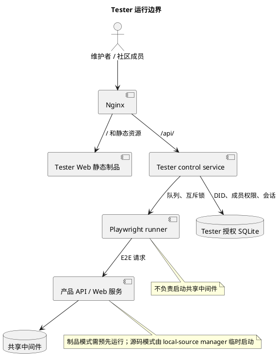

# 测试环境现状与架构

> 最近核对：2026-11-28（Tester 版本、控制服务、调度配置和最近运行报告；公共中间件与产品服务快照仍为 2026-11-25）
> 本文区分 Tester 自身健康与产品 E2E 环境就绪；两者不能互相替代。

## 当前结论

**Tester 控制面 0.1.26 readiness 检查通过，每日全量计划已启用；GPU 全项目 E2E 依赖尚未完成新一轮现场核验。**

2026-11-28 确认 Tester service `0.1.26` 正在运行，`health-check.sh --level readiness` 的控制服务和 runner 两项均通过。每日全量计划已设置为 03:00 Asia/Shanghai，控制服务日志确认调度已启用；main watcher 和产品源码部署开关保持启用。配置修改前已执行项目配置备份。此次没有核验 `tester-web` 制品版本、Nginx 配置或所有产品服务，因此它们的现场状态仍以 2026-11-25 快照为准。

最新全量报告仍是 2026-11-25，结果为 197 通过、413 失败、186 跳过，共 796 项。11-28 的 Router、Marketplace、Wallet main 批次完成产品构建或部署后，打包版 Tester 从无 `.git` 的安装目录执行 Git worktree 准备，导致用例 runner 失败。Book 的 main 批次使用了旧项目名 `books`，部署适配器拒绝该名称；Agent 被配置为 watcher 项目，但没有部署适配器，也因此失败。本次 PR 将 `books` 规范化为 `book`、禁用没有适配器的 watcher 项目，并让制品模式使用包内 runner。当前 GPU 制品仍有上述问题，升级后需手动重跑相应范围。Router 最近本地源码测试仍为 116/117，唯一失败在 `group-route-order.spec.ts` 的分组路由场景。Tester readiness 只检查控制 API 和 runner，不会逐个检查所有产品服务。

公共中间件、Node API/Web、Warehouse、Chat、Social、Project、Knowledge 和 Orchestrator 的状态没有在 2026-11-28 重新核验。2026-11-25 快照记录这些服务存在未启动或配置未就绪的项目，因此不能据本次 Tester readiness 推断全项目 E2E 已可运行。

## 组件与边界



Tester 负责钱包身份授权、用例浏览、任务排队、互斥执行、结果报告和受支持项目的源码 watcher。它不负责启动公共 middleware，也不会隐式启动所有社区产品。

产品测试有两类依赖：

1. **共享中间件**：PostgreSQL、Redis、MySQL、Mailpit，以及按产品需要使用的 Manticore、PlantUML、OnlyOffice、对象存储等。中间件由各自 Compose/运维流程管理。
2. **产品服务依赖**：例如 Router 身份用例依赖 Node issuer 与 Mailpit，Chat 会调用 Router 和 Warehouse，Wallet dApp 用例需要相应产品 API/Web 页面。

逻辑依赖关系见[项目依赖图](project-dependency-map.md)。每轮运行前还应使用 preflight 检查实际端口、配置、数据库和迁移状态。

## GPU 主机快照

以下产品服务和共享中间件为 2026-11-25 核对结果。Tester service 行已更新为 2026-11-28 检查值。修改主机配置后应重新执行检查，不要把历史快照当作长期不变的承诺。

| 范围 | 已核实状态 | 对测试的影响 |
| --- | --- | --- |
| Tester service | `0.1.26` active；2026-11-28 readiness 2/2 通过；每日计划 03:00 启用 | 控制面和 runner 自检通过；每日计划下一次在配置时刻运行 |
| Tester Web | 最近核验值仍为 2026-11-25 的快照 `0.1.19`；本轮未检查 | 与 service 是独立制品，需在 Web 发布后分别核对 |
| 系统 Nginx | `nginx -t` 通过；使用 `/etc/nginx/conf.d/tester.conf` | 根路径静态控制台和 `/api/` 入口可用 |
| 匿名认证状态 | `/api/auth/status` 返回 401 | 钱包登录入口受服务端认证保护 |
| 公共中间件 | PostgreSQL、Redis、MySQL、Mailpit、Manticore、PlantUML、OnlyOffice 等容器在运行 | 容器运行不代表产品数据库、账号和 schema 都正确 |
| Router | API 端口 3011 有进程监听 | 可作为当前部署服务被调用；Router Web 未确认运行 |
| 其他产品服务 | Node、Warehouse、Chat、Social、Project、Knowledge、Orchestrator 等未确认运行 | 对应端到端场景目前不能视为可用 |
| 本地源码测试配置 | `/root/code` 有 Node、Router 等源码；Orchestrator backend `.env` 缺失 | 可运行准备充分的单项目源码模式；全量仍被缺失配置/服务阻断 |
| 临时源码端口 | 最近一次源码回归后无临时监听 | 测试结束已回收临时服务 |

执行一次现场核对：

```bash
readlink -f /opt/deploy/tester
/opt/deploy/tester/scripts/health-check.sh --level readiness --format json
/opt/deploy/tester/scripts/health-check.sh --level all --format json
curl -sS -o /dev/null -w '%{http_code}\n' https://tester.tidukongjian.com/
curl -sS -o /dev/null -w '%{http_code}\n' https://tester.tidukongjian.com/api/auth/status
nginx -t
docker ps --format '{{.Names}} {{.Status}}'
ss -ltn
```

访问 Tester API 的 `401` 是匿名状态的预期响应；健康检查通过也不是产品 E2E 通过的证据。E2E 是否可运行，应另外执行项目 preflight 和代表性用例。

## 配置归属

敏感配置保留在 GPU 主机受限目录，不复制到仓库或本文件：

| 配置内容 | 现场位置 | 修改原则 |
| --- | --- | --- |
| Tester 控制参数 | `/opt/deploy/tester/runtime.json` | 由项目升级钩子复制到每个版本；修改前备份，通过 starter 重启 |
| 产品 URL 与测试凭据 | `/opt/deploy/tester/.env.local` | 地址须对应真实监听服务；凭据不得进入命令输出、文档或报告 |
| watcher 项目清单 | `/opt/deploy/tester/projects.json` | `enabled` 只控制 main watcher，不控制 Playwright 全量项目范围 |
| Tester 报告和私有运行数据 | `/data/test-results` 与 `/data/test-results-private` | 前者可由站点发布；后者禁止被 Nginx 暴露 |
| Tester 登录与控制数据库 | 私有控制数据目录中的 SQLite | 启动时自动 migration；由 config backup 做一致性备份 |
| 产品源码 | `/root/code/<repo>` | 以各仓库 `origin/main` 为准；本地源码 runner 用 detached worktree |

GPU 当前配置使用 `/opt/deploy/tester/runtime.json`、`/opt/deploy/tester/projects.json` 和 `/opt/deploy/tester/.env.local`。`runtime.json` 中的每日计划于 2026-11-28 启用，配置修改前生成了 `/opt/backup` 中的标准备份归档。更新 `.env.local` 时不要只写入 URL 让 preflight 变绿；先确认服务确实启动、健康检查通过，并核实数据库迁移已应用。Watcher 开启不等于服务已部署。当前 watcher 适配和源码模式依赖范围见 [控制服务](test-control.md) 与[本地源码模式](local-source-mode.md)。

## 启动和验证顺序

制品模式和本地源码模式是两种不同流程。

制品模式：

1. 按产品依赖图启动所需 middleware。
2. 创建产品数据库、账号并完成产品自己的 migration。
3. 按服务依赖顺序启动 Node/Router/Warehouse 等 API 与 Web。
4. 对每个产品运行 `local_test_readiness.py <project> --require-services` 或相应部署健康检查。
5. 先跑单项目 smoke，再跑完整项目套件。

本地源码模式会在已有 middleware 上启动产品 `origin/main` 的 detached worktree，详见[本地源码测试模式](local-source-mode.md)。它会隔离 Router 的 E2E PostgreSQL 数据库，并在测试结束后恢复本地 Node 应用回调和停止本轮进程。它不会为 Orchestrator 凭空生成 backend `.env`，也不会重置 Project/Social 共享数据库。

## 文档迭代

服务依赖、启动入口、端口或数据库变化时，同一 PR 应更新：

- `local-test-dependencies.json`：本地源码模式的仓库和服务闭包；
- `scripts/local_test_readiness.py` / `scripts/local-source-services.py`：preflight、配置覆盖和生命周期；
- `docs/project-dependency-map.json` 与 `docs/project-dependency-map.md`：逻辑依赖图；
- 本文：GPU 现场状态、测试机差异和验证日期；
- 产品测试用例文档及 Playwright spec：场景、环境前置条件和自动化结果。

改完先运行 `python3 scripts/test_local_source_mode.py`、相关 preflight 和代表性 E2E，再按 Tester 仓库交付流程提交。
