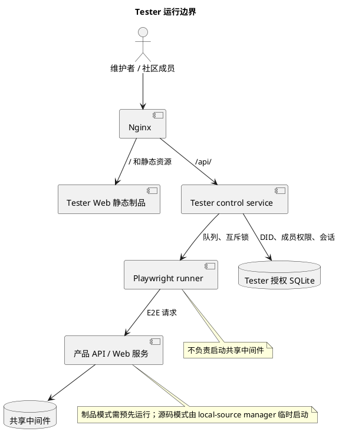

# 测试环境现状与架构

> 最近核对：2026-11-25（GPU 测试机只读检查）
> 本文区分 Tester 自身健康与产品 E2E 环境就绪；两者不能互相替代。

## 当前结论

**Tester 控制面正常工作，GPU 主机尚未准备好随时运行全项目 E2E。**

本次确认 Tester service `0.1.20` 正在运行，`health-check.sh --level readiness` 和 `--level all` 均通过；`https://tester.tidukongjian.com/` 返回控制台 HTML，匿名 `/api/auth/status` 返回预期的 `401`，`nginx -t` 通过。当前页面由 `tester-web 0.1.19` 提供，service 为 `0.1.20`；Web 与 service 是独立制品，升级时要分别核对版本和来源提交。

这些结果只证明 Tester 控制 API、测试 runner 的自检、Nginx 和静态控制台可用。Tester health check 当前只有控制 API 和 runner 两项，不会逐个检查所有产品服务。

GPU 上的产品服务目前只确认 Router API 端口在监听。Node API/Web、Warehouse、Chat、Social、Project、Knowledge 和 Orchestrator 等产品服务没有运行；因此登录控制台不代表用户可以成功执行这些项目的 E2E。最近报告时间也不是本次核对时间，不能用旧报告表示当前质量状态。

Tester `main` 上已修复 Router 本地源码模式的端口隔离和身份登录依赖，并在隔离源码服务上完成 Router 全套回归（98 通过、0 失败、11 跳过）。但 GPU 当前运行的 `tester-service-v0.1.20-b9aa158` 和 `tester-web-v0.1.19-3f1e9bf` 早于该修复提交；修复须经标准打包和升级后才会进入当前部署。该源码回归结果也不能替代 GPU 当前制品模式的全套产品验证。

## 组件与边界



Tester 负责钱包身份授权、用例浏览、任务排队、互斥执行、结果报告和受支持项目的源码 watcher。它不负责启动公共 middleware，也不会隐式启动所有社区产品。

产品测试有两类依赖：

1. **共享中间件**：PostgreSQL、Redis、MySQL、Mailpit，以及按产品需要使用的 Manticore、PlantUML、OnlyOffice、对象存储等。中间件由各自 Compose/运维流程管理。
2. **产品服务依赖**：例如 Router 身份用例依赖 Node issuer 与 Mailpit，Chat 会调用 Router 和 Warehouse，Wallet dApp 用例需要相应产品 API/Web 页面。

逻辑依赖关系见[项目依赖图](project-dependency-map.md)。每轮运行前还应使用 preflight 检查实际端口、配置、数据库和迁移状态。

## GPU 主机快照

以下为 2026-11-25 核对结果；修改主机配置后应重新执行检查，不要把它当作长期不变的承诺。

| 范围 | 已核实状态 | 对测试的影响 |
| --- | --- | --- |
| Tester service | `0.1.20` active；readiness/all 通过 | 控制面可接收请求并启动 runner |
| Tester Web | `0.1.19`；站点根路径返回 200 | 控制台可打开；与 service 版本不同，发布时须核对独立制品 |
| 系统 Nginx | `nginx -t` 通过；使用 `/etc/nginx/conf.d/tester.conf` | 根路径静态控制台和 `/api/` 入口可用 |
| 匿名认证状态 | `/api/auth/status` 返回 401 | 钱包登录入口受服务端认证保护 |
| 公共中间件 | PostgreSQL、Redis、MySQL、Mailpit、Manticore、PlantUML、OnlyOffice 等容器在运行 | 容器运行不代表产品数据库、账号和 schema 都正确 |
| Router | API 端口 3011 有进程监听 | 可作为当前部署服务被调用；Router Web 未确认运行 |
| 其他产品服务 | Node、Warehouse、Chat、Social、Project、Knowledge、Orchestrator 等未确认运行 | 对应端到端场景目前不能视为可用 |
| 本地源码测试配置 | `/root/code` 有 Node、Router 等源码；Orchestrator backend `.env` 缺失 | 可运行准备充分的单项目源码模式；全量仍被缺失配置/服务阻断 |
| 临时源码端口 | 最近一次源码回归后无临时监听 | 测试结束已回收临时服务 |

执行一次现场核对：

```bash
readlink -f /opt/deploy/tester
/opt/deploy/tester/scripts/health-check.sh --level readiness --format json
/opt/deploy/tester/scripts/health-check.sh --level all --format json
curl -sS -o /dev/null -w '%{http_code}\n' https://tester.tidukongjian.com/
curl -sS -o /dev/null -w '%{http_code}\n' https://tester.tidukongjian.com/api/auth/status
nginx -t
docker ps --format '{{.Names}} {{.Status}}'
ss -ltn
```

访问 Tester API 的 `401` 是匿名状态的预期响应；健康检查通过也不是产品 E2E 通过的证据。E2E 是否可运行，应另外执行项目 preflight 和代表性用例。

## 配置归属

敏感配置保留在 GPU 主机受限目录，不复制到仓库或本文件：

| 配置内容 | 现场位置 | 修改原则 |
| --- | --- | --- |
| Tester 控制参数 | `/opt/deploy/tester/runtime.json` | 由项目升级钩子复制到每个版本；修改前备份，通过 starter 重启 |
| 产品 URL 与测试凭据 | `/opt/deploy/tester/.env.local` | 地址须对应真实监听服务；凭据不得进入命令输出、文档或报告 |
| watcher 项目清单 | `/opt/deploy/tester/projects.json` | `enabled` 只控制 main watcher，不控制 Playwright 全量项目范围 |
| Tester 报告和私有运行数据 | `/data/test-results` 与 `/data/test-results-private` | 前者可由站点发布；后者禁止被 Nginx 暴露 |
| Tester 登录与控制数据库 | 私有控制数据目录中的 SQLite | 启动时自动 migration；由 config backup 做一致性备份 |
| 产品源码 | `/root/code/<repo>` | 以各仓库 `origin/main` 为准；本地源码 runner 用 detached worktree |

GPU 当前文件仍位于旧路径 `/data/test-results-private/control/tester.env`，下次标准服务升级会由 Tester 项目钩子迁移到 `/opt/deploy/tester/.env.local`，并切换 systemd runtime 路径。更新 `.env.local` 时不要只写入 URL 让 preflight 变绿；先确认服务确实启动、健康检查通过，并核实数据库迁移已应用。Watcher 开启不等于服务已部署。当前 watcher 适配和源码模式依赖范围见 [控制服务](test-control.md) 与[本地源码模式](local-source-mode.md)。

## 启动和验证顺序

制品模式和本地源码模式是两种不同流程。

制品模式：

1. 按产品依赖图启动所需 middleware。
2. 创建产品数据库、账号并完成产品自己的 migration。
3. 按服务依赖顺序启动 Node/Router/Warehouse 等 API 与 Web。
4. 对每个产品运行 `local_test_readiness.py <project> --require-services` 或相应部署健康检查。
5. 先跑单项目 smoke，再跑完整项目套件。

本地源码模式会在已有 middleware 上启动产品 `origin/main` 的 detached worktree，详见[本地源码测试模式](local-source-mode.md)。它会隔离 Router 的 E2E PostgreSQL 数据库，并在测试结束后恢复本地 Node 应用回调和停止本轮进程。它不会为 Orchestrator 凭空生成 backend `.env`，也不会重置 Project/Social 共享数据库。

## 文档迭代

服务依赖、启动入口、端口或数据库变化时，同一 PR 应更新：

- `local-test-dependencies.json`：本地源码模式的仓库和服务闭包；
- `scripts/local_test_readiness.py` / `scripts/local-source-services.py`：preflight、配置覆盖和生命周期；
- `docs/project-dependency-map.json` 与 `docs/project-dependency-map.md`：逻辑依赖图；
- 本文：GPU 现场状态、测试机差异和验证日期；
- 产品测试用例文档及 Playwright spec：场景、环境前置条件和自动化结果。

改完先运行 `python3 scripts/test_local_source_mode.py`、相关 preflight 和代表性 E2E，再按 Tester 仓库交付流程提交。
