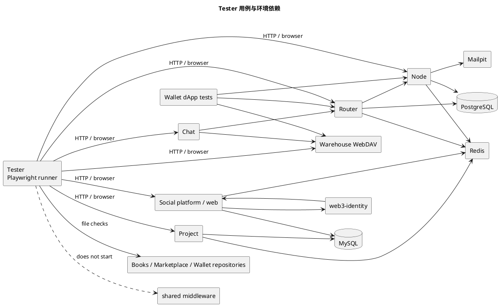

# Tester 测试机架构与环境运行手册

> 适用环境：Tester 专用测试环境（连接信息由受限运维清单维护）
> 核对日期：2026-11-23
> 维护原则：本文描述当前代码和主机状态；服务、配置或启动方式变化后同步更新。

## 1. Tester 的职责与边界

Tester 是 Playwright 测试控制器和报告服务。它负责：

1. 运行 Tester 包内的 E2E 用例，并生成项目报告、JUnit 和全量报告。
2. 通过控制页/API 接收手动测试请求、调度队列和共享测试锁。
3. 按项目配置轮询已启用仓库的 `origin/main`；发现新 commit 后，对有已验证适配器的项目执行定向更新和测试。
4. 提供健康检查、浏览器隔离、报告脱敏发布和每日全量调度能力。

Tester **不会**启动 PostgreSQL、Redis、MySQL、Mailpit 等共享中间件，也不会启动所有产品 API、网页或后台服务。E2E 用例默认连接已经运行的服务；全量脚本在开跑前只对 Warehouse 和 Node 网页做一次预热请求，失败时记日志并继续执行。

需要直接按社区源码运行时，使用[本地源码测试模式](local-source-mode.md)。该模式先把每个依赖仓库 materialize 为 `origin/main` 的 detached worktree，再按项目依赖启动产品服务；它不会覆盖 `/root/code` 的本地改动，也不会自动重置共享数据库。制品模式和本地源码模式必须分别记录测试结果。

Tester 自身制品由 Deployer 按标准服务包流程升级。Tester 的产品 watcher 与 Deployer 的 Tester 版本升级是两条独立链路。

## 2. 运行组件

GPU 机当前的 Tester 组件如下：

| 组件                                                         | 运行方式                                                                 | 当前职责                                                                |
| ------------------------------------------------------------ | ------------------------------------------------------------------------ | ----------------------------------------------------------------------- |
| `tester-control.service`                                     | systemd，稳定工作目录 `/opt/deploy/tester`                               | 控制 API、队列、产品 main watcher、可选每日调度                         |
| `tester-report.service`                                      | systemd + Nginx                                                          | 提供报告站点                                                            |
| `tester-router.service`                                      | systemd，监听 3011                                                       | Router 的 API 实例，供 Router/Chat/Wallet 测试调用                      |
| `scripts/tester-control-projects.json`（部署时复制并可外置） | 当前路径 `/data/test-results-private/control/consolidated-projects.json` | 控制 watcher 的仓库、启用状态和禁用理由；不决定全量 Playwright 项目名单 |
| `tester.env`                                                 | 当前外置路径 `/data/test-results-private/control/tester.env`             | 产品 URL、仓库路径和测试凭据；由 `TESTER_ENV_FILE` 指定                 |
| `runtime-artifact.json`                                      | 当前外置路径 `/data/test-results-private/control/runtime-artifact.json`  | Tester 运行目录、锁、服务和调度选项                                     |

核心代码路径：

- [playwright.config.ts](../playwright.config.ts) 定义 11 个产品 Playwright 项目。
- [playwright.safe.config.ts](../playwright.safe.config.ts) 从全量集合排除 Knowledge，GPU 机的安全全量运行因此包含另外 10 个项目。
- [tester-control.py](../scripts/tester-control.py) 轮询、入队和分派测试。
- [run-full-on-test-machine.sh](../scripts/run-full-on-test-machine.sh) 默认连接已运行服务；启用[本地源码测试模式](local-source-mode.md)后按依赖启动源码服务并在运行结束时回收。
- [deploy-and-test-project.sh](../scripts/deploy-and-test-project.sh) 对受支持的单个项目执行更新适配和定向测试。
- [global-setup.ts](../scripts/global-setup.ts) 预热 Warehouse/Node URL；连接失败只记日志，不阻止测试。

## 3. 两类依赖

Agent 和社区成员可先查看[项目与 E2E 依赖图](project-dependency-map.md)或线上只读图 `/architecture`。它聚焦项目之间的服务调用和共享依赖；本手册继续记录测试机的实际配置与启动状态。

第一类是**共享中间件**。不同产品共同使用 PostgreSQL、Redis、MySQL、Mailpit、搜索或对象存储等服务。它们由 Deployer 的 middleware 目录、Docker Compose 或独立运维流程启动；Tester 不负责拉起或初始化它们。容器显示 `healthy` 只说明容器级探针通过，不代表产品数据库已创建、迁移完成、凭据正确或业务服务健康。

第二类是**产品服务之间的依赖**。它们目前散落在产品代码、Tester helper 和用例中，没有集中式依赖清单，也没有统一的自动启动顺序。例如：

| 测试场景                       | 必须可用的服务或资源                                                                                                     |
| ------------------------------ | ------------------------------------------------------------------------------------------------------------------------ |
| Router 的真实钱包身份登录      | Router API + Node 身份 API + Mailpit 邮件收件箱；Node 自身还依赖 PostgreSQL/Redis                                        |
| Chat 的 Router 页面/令牌用例   | Chat 服务 + Router API；存储同步用例还要求 Warehouse WebDAV                                                              |
| Wallet 的 dApp 集成            | Wallet 扩展文件 + 对应 dApp 页面；`dapp-node`、`dapp-router`、`dapp-warehouse` 分别依赖 Node、Router、Warehouse 网页/API |
| Social 的认证和用户流程        | Social platform API + web3-identity；页面用例还要求 Social Web；后端依赖 MySQL/Redis                                     |
| Project 的业务流程             | Project 服务 + MySQL/Redis，部分功能还依赖 PlantUML 等服务                                                               |
| Warehouse 的 API/UI            | Warehouse API/WebDAV/Admin + 网页；数据库与可选对象存储需按 Warehouse 配置准备                                           |
| Orchestrator 与 Warehouse 集成 | Orchestrator API/Web + Warehouse API；PostgreSQL 按 Orchestrator 配置启用                                                |
| Books / Marketplace 基础测试   | 本机仓库目录；不需要常驻服务。设置对应 `*_BASE_URL` 后会额外访问在线站点                                                 |

依赖关系示意：



## 4. GPU 测试机当前状态

截至 2026-11-24，Tester 服务、系统 `nginx.service` 和 Router API 处于运行状态；PostgreSQL、Redis、MySQL、Mailpit、Manticore、PlantUML 也已由 `/opt/deploy` 下的 Compose 项目启动，数据库/容器健康检查通过。MySQL 使用既有 `/data/mysql` 持久数据；切勿把 `/root/code/deployer/middleware/mysql/data` 覆盖到该数据目录。Project 库有 218 条迁移记录，Social 的 Flyway 有 5 条成功记录；两边应用数据库和用户都已创建。产品服务尚未启动，因此完整全量 E2E 仍不能开始。

Orchestrator 仓库现已位于 `/root/code/orchestrator`，处于社区 `main` 且工作区干净；backend `.env` 尚未配置。MinIO 对当前 Tester E2E 依赖图是可选组件，不纳入默认启动集合。PlantUML 与 OnlyOffice 已由 `/opt/deploy` Compose 配置启动并通过 HTTP/health 检查。Docker daemon 已 reload 新配置的镜像源。容器 Nginx 未启动；公网 Tester 站点继续由系统 `nginx.service` 提供。

当前配置文件中的主要 URL：

| 配置                                                             | 当前值                      | 检查结果与修正                                                                                                                                    |
| ---------------------------------------------------------------- | --------------------------- | ------------------------------------------------------------------------------------------------------------------------------------------------- |
| `WAREHOUSE_BASE_URL`                                             | `http://localhost:5173`     | 网页未启动；WebDAV `6065`、Admin `6066` 也未监听。建议统一使用 `127.0.0.1`                                                                        |
| `NODE_BASE_URL`                                                  | `http://localhost:8100`     | 配错成 API 端口；模板规定网页为 `8991`，API 保持 `NODE_API_URL=http://127.0.0.1:8100`                                                             |
| `ROUTER_BASE_URL`                                                | `http://localhost:3011`     | API `/api/v1/public/status` 返回 200；根路径返回 404。补 `ROUTER_WEB_URL=http://127.0.0.1:5181` 并启动 Router Web，不能把 API 的 3011 当网页      |
| `CHAT_BASE_URL`                                                  | `http://127.0.0.1:3020`     | Chat 服务未启动                                                                                                                                   |
| `SOCIAL_BASE_URL` / `SOCIAL_WEB_URL` / `SOCIAL_IDENTITY_URL`     | `:8888` / `:8082` / `:8901` | 对应服务均未启动                                                                                                                                  |
| `PROJECT_BASE_URL`                                               | `http://localhost:2222`     | Project 服务未启动；数据库、应用用户及 218 条迁移记录已存在                                                         |
| `ORCHESTRATOR_BASE_URL` / `ORCHESTRATOR_API_URL`                 | 未配置                      | `/root/code/orchestrator` main checkout 已准备好；backend `.env` 尚未配置，Tester `.env` 仍需 `ORCHESTRATOR_*`      |
| `MARKETPLACE_REPO_PATH` / `BOOKS_REPO_PATH` / `WALLET_REPO_PATH` | `/root/code/...`            | 仓库目录存在；这部分本地文件用例可独立运行                                                                                                        |

上述本机 URL 即使服务未启动也仍是非空值，因此很多用例不会因“未配置”而跳过，而会以连接拒绝失败。`localhost` 在 Linux 上可能先解析到 `::1`；测试机本地服务建议统一写 `127.0.0.1`。

当前自动更新项目清单与 Tester 项目定义也不完全一致：配置曾启用 `agent`，但 Playwright 没有 `agent` 项目，`deploy-and-test-project.sh` 也不支持 `agent`；`orchestrator` 仓库现已存在，但没有旧的单项目部署适配器，backend `.env` 也尚未配置。旧部署适配器目前只支持 `router`、`chat`、`books`、`marketplace`、`wallet`。本地源码模式可读取 Orchestrator main，但完整全量运行前仍须补齐其运行配置和依赖；`agent` 应保持 disabled/移除。

`enabled` 只影响 watcher 是否跟踪项目 main；它不会从全量测试中排除该项目。每日全量调度当前也关闭，runtime 没有 `TESTER_DAILY_RUN_ENABLED=true`。最新全量报告仍是 2026-11-21：789 项中 196 通过、405 失败、188 跳过；失败样例包含 Warehouse 连接 `localhost:6065` 被拒。环境修好前，这份全量报告主要反映依赖未就绪，不能作为产品质量结论。

该次安全全量运行覆盖 Books、Chat、Marketplace、Node、Orchestrator、Project、Router、Social、Wallet、Warehouse 共 10 个 Playwright 项目；Knowledge 被 safe config 明确排除。项目范围来自 Playwright 配置，不读取 watcher 的 `enabled` 值。

该次全量报告的分布如下，能看到 Books/Marketplace 的文件型测试可以通过，而多数在线服务项目因目标服务未启动而失败：

| Playwright 项目 | 通过 | 失败 | 跳过 |
| --------------- | ---: | ---: | ---: |
| Books           |   30 |    0 |    5 |
| Marketplace     |   53 |    0 |    5 |
| Wallet          |   50 |   37 |    7 |
| Router          |   59 |   32 |   19 |
| Chat            |    2 |   69 |   23 |
| Node            |    0 |   51 |    9 |
| Project         |    1 |   84 |   59 |
| Social          |    1 |   61 |   28 |
| Warehouse       |    0 |   71 |   23 |
| Orchestrator    |    0 |    0 |   10 |

## 5. 配置应如何修改

GPU 机配置分三份，修改前先备份：

```text
/data/test-results-private/control/runtime-artifact.json       # TESTER_* 控制参数
/data/test-results-private/control/tester.env                  # 产品 URL、测试账号、密钥
/data/test-results-private/control/consolidated-projects.json   # watcher 项目及自动更新开关
```

先备份 `/data/test-results-private/control/tester.env`、`runtime-artifact.json` 和 `consolidated-projects.json`，再按真实服务端口修改。建议在 `tester.env` 中确认或修改这些非敏感地址：

```dotenv
WAREHOUSE_BASE_URL=http://127.0.0.1:5173
WAREHOUSE_ADMIN_URL=http://127.0.0.1:6066
WAREHOUSE_WEBDAV_URL=http://127.0.0.1:6065

NODE_BASE_URL=http://127.0.0.1:8991
NODE_API_URL=http://127.0.0.1:8100

ROUTER_BASE_URL=http://127.0.0.1:3011
ROUTER_WEB_URL=http://127.0.0.1:5181
CHAT_BASE_URL=http://127.0.0.1:3020

SOCIAL_BASE_URL=http://127.0.0.1:8888
SOCIAL_WEB_URL=http://127.0.0.1:8082
SOCIAL_IDENTITY_URL=http://127.0.0.1:8901
PROJECT_BASE_URL=http://127.0.0.1:2222

ORCHESTRATOR_BASE_URL=http://127.0.0.1:5174
ORCHESTRATOR_API_URL=http://127.0.0.1:3900
```

Marketplace、Books、Wallet 的仓库路径继续指向 `/root/code/marketplace`、`/root/code/books`、`/root/code/wallet`。URL 应与实际启动端口一致；不要只为让 `env:check` 通过而写入地址。将 `consolidated-projects.json` 中不受支持的 `agent` 禁用；在各项目部署适配、服务端口及回滚都完成验证前，不要启用 Node、Project、Social、Warehouse 或 Orchestrator 的自动更新。可用下列脚本只修改 watcher 标志，保留其它项目配置：

```bash
python3 - <<'PY'
import json
from pathlib import Path
p = Path("/data/test-results-private/control/consolidated-projects.json")
d = json.loads(p.read_text())
d["projects"]["agent"]["enabled"] = False
d["projects"]["agent"]["reason"] = "Tester has no agent Playwright project or deployment adapter."
tmp = p.with_suffix(".json.tmp")
tmp.write_text(json.dumps(d, ensure_ascii=False, indent=2) + "\n")
tmp.chmod(0o600)
tmp.replace(p)
PY
```

`runtime-artifact.json` 当前已经启用 `TESTER_WATCH_UPSTREAM_MAIN=1` 与 `TESTER_ALLOW_PRODUCT_SOURCE_DEPLOY=1`。每日全量调度仍关闭；只有当上述所有全量项目都准备好并通过一次人工全量验证后，才配置 `TESTER_DAILY_RUN_ENABLED=true`、时间和时区。

## 6. 缺失服务的启动顺序

先启动共享中间件，再启动产品后端，最后启动网页。所有命令都在 GPU 机上执行。以下命令只启动服务；首次建库、迁移、密钥仓初始化和产品配置必须按各产品文档单独完成。**不要对共享数据库运行 `docker compose down -v`，不要覆写生产/测试密钥。**

### 6.1 共享中间件

只启动当前项目需要的服务；每个 Compose 命令使用各自的目录和已有 `.env`：

```bash
cd /opt/deploy/postgresql && docker compose up -d
cd /opt/deploy/redis && docker compose up -d
cd /opt/deploy/mysql && docker compose up -d
cd /opt/deploy/manticore && docker compose up -d
cd /opt/deploy/mailpit && docker compose up -d
cd /opt/deploy/plantuml && docker compose up -d
cd /opt/deploy/onlyoffice && docker compose up -d
```

当前上述服务均已运行。首次启动或迁移 MySQL 时只使用 `/opt/deploy/mysql` 配置和 `/data/mysql` 持久数据目录；源码仓库中的 MySQL data 是另一份数据库，禁止覆盖或与其互换。PlantUML 和 OnlyOffice 绑定本机端口。PostgreSQL/Redis/MySQL 容器健康仍不代表业务配置正确；本次核验到 Project 有 218 条迁移记录，Social Flyway 有 5 条成功记录。MinIO 不在 Tester 当前全量依赖闭包中，不需启动。容器 Nginx 按单实例要求不启动。

### 6.2 产品服务

| 产品                 | 启动方式                                                                                                                                                                                                                                             | E2E 前置条件                                                                                          |
| -------------------- | ---------------------------------------------------------------------------------------------------------------------------------------------------------------------------------------------------------------------------------------------------- | ----------------------------------------------------------------------------------------------------- |
| Router API           | 已有 `tester-router.service`；`systemctl start tester-router.service`                                                                                                                                                                                | API readiness 通过；Router 数据库和 Redis 配置可用                                                    |
| Router Web           | `cd /root/code/router/web && VITE_SERVER=http://127.0.0.1:3011 npm run dev -- --host 127.0.0.1 --port 5181`                                                                                                                                          | `ROUTER_WEB_URL` 指向 5181；API 指向 3011                                                             |
| Node API             | `cd /root/code/node && npm run dev:secure`                                                                                                                                                                                                           | 先检查 `config.js`、加密 secrets vault、PostgreSQL/Redis；需交互输入 vault 密码时在受控终端启动       |
| Node Web             | `cd /root/code/node/web && npm run dev -- --host 127.0.0.1 --port 8991`                                                                                                                                                                              | `NODE_BASE_URL=:8991`、`NODE_API_URL=:8100`；Router 身份流程还需 Mailpit                              |
| Warehouse API/WebDAV | `cd /root/code/warehouse && go run ./cmd/warehouse -c config.yaml`                                                                                                                                                                                   | 检查 `config.yaml`、PostgreSQL 和 Warehouse readiness                                                 |
| Warehouse Web        | `cd /root/code/warehouse/web && npm run dev -- --host 127.0.0.1 --port 5173`                                                                                                                                                                         | `WAREHOUSE_BASE_URL=:5173`；API/WebDAV `6065`、Admin `6066`                                           |
| Chat                 | 源码开发模式 `cd /root/code/chat && npm run dev`；如果部署了安装包，可执行 `cd /opt/deploy/chat && bash scripts/starter.sh start`                                                                                                                    | Chat `3020`、Router `3011`、Warehouse WebDAV `6065`；对话用例还需要有效 LLM keys/model                |
| Social 后端          | `cd /root/code/social && ./cmd local-start`                                                                                                                                                                                                          | MySQL 数据库/迁移、Redis；启动会运行 platform、server、rtc、web3-identity 后端服务                    |
| Social Web           | `cd /root/code/social/web && npm run serve -- --host 127.0.0.1 --port 8082`                                                                                                                                                                          | backend `8888`、identity `8901` 和 Web `8082` 都可用                                                  |
| Project              | 检查 `.env` 和 MySQL/Redis 后执行 `cd /root/code/project && ./cmd local-start`                                                                                                                                                                       | 端口 2222；首次环境准备按 Project 部署手册执行 `./cmd local-install`，不要把安装/迁移当成无副作用启动 |
| Orchestrator         | GPU 机当前缺少 `/root/code/orchestrator`；先按批准流程准备仓库、`backend/.env` 和依赖。之后 backend `cd /root/code/orchestrator/backend && uv run orchestrator`，web `cd /root/code/orchestrator/web && npm run dev -- --host 127.0.0.1 --port 5174` | API 3900、Web 5174；设置正确 `ORCHESTRATOR_*`，需要 Warehouse 时再启动并配置 Warehouse                |
| Books / Marketplace  | 不启动服务                                                                                                                                                                                                                                           | 读取各自仓库目录                                                                                      |
| Wallet               | 不启动服务                                                                                                                                                                                                                                           | Playwright 从 `WALLET_REPO_PATH` 加载扩展；具体 dApp 用例仍需 Node、Router 或 Warehouse 页面          |

`npm run dev`、Vite、Go `run` 和 Spring/PHP 本地启动属于开发态进程，不会自动注册 systemd。若要长期无人值守运行，应为每个服务配置独立、可监控的服务管理方式；不要把多个产品塞进 Tester 的 systemd unit。

## 7. 验证顺序

1. 检查中间件容器和业务库初始化状态；查看项目自己的日志和 readiness 结果。
2. 对已启动的 API 执行项目 `scripts/health-check.sh --level all`；没有统一脚本的项目按各自部署手册检查。
3. 运行 Tester 的 URL/路径预检，确认 `NODE_BASE_URL`、`ROUTER_WEB_URL`、Orchestrator 等变量与服务实际端口一致。命令为 `cd /opt/deploy/tester && TEST_ENV=local TESTER_ENV_FILE=/data/test-results-private/control/tester.env npm run env:check`；它检查所有产品 URL/仓库路径，因此当前缺服务时应失败。它是地址预检，不替代项目 readiness 检查。
4. 先逐项目运行，不要先启动全量：

   ```bash
   TESTER_RUNTIME_CONFIG=/data/test-results-private/control/runtime-artifact.json \
     /opt/deploy/tester/scripts/test.sh --suite e2e --project router --list-cases
   TESTER_RUNTIME_CONFIG=/data/test-results-private/control/runtime-artifact.json \
     /opt/deploy/tester/scripts/test.sh --suite e2e --project router --timeout 600
   ```

5. 逐项目报告确认目标 SHA、通过/失败/跳过数量及失败原因都合理后，再运行全量套件。只有每日全量结果没有因缺依赖而产生大量连接错误/跳过，才将其作为发布质量门禁。

Tester 自身 `health-check.sh --level all` 检查的是 Tester 控制和本地 runner，不代表上表的产品服务都正常。每次环境变更后应同步更新本文件的配置值、依赖、服务启动入口、验证结果和核对日期。
